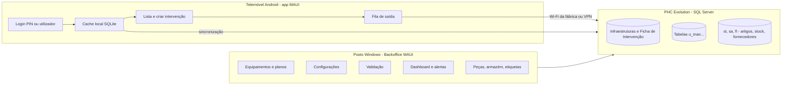

# Arquitetura, reaproveitamento e modelo de dados (proposta)

Estado: **proposta de planeamento**. Os nomes reais das tabelas e campos do PHC só se conhecem depois do levantamento (tarefa P1-T01, só SELECT). Tudo o que está marcado como candidato pode mudar.

## 1. Arquitetura alvo

Decisão D-03: o acesso a dados segue a base do LandeiroMaui (Dapper direto ao SQL Server, um login SQL por utilizador). Risco R-03 no `00-global.md`.

## 2. O que se reaproveita do LandeiroMaui (C:\_SigmaRepos\Landeiro-Desmancha\LandeiroMaui)

| Peça | Onde | Uso |
|---|---|---|
| Ecrã de login | `Components/Pages/Login/Login.razor` | Base do login; acrescenta-se o PIN |
| Sessão e perfis | `Services/UserStateService.cs` (`LoginBDAsync`, `RecarregarRolesAsync`, `HasRole`, `GetLandingRoute`) e `SafeSecureStorage` | Sessão longa; roles novos em `Helpers/Perfis` (constantes) |
| Menu por perfil | `NavMenu.razor` com `HasRole(Perfis.X)` fora do ecrã | Acesso ao módulo Manutenção |
| Padrão de módulo | `Components/Pages/<Modulo>/`, `Interfaces/<Modulo>/`, `Services/<Modulo>/`, `Models/<Modulo>/`, registo manual em `MauiProgram.cs` | Módulo `Manutencao` |
| Dados | Dapper, `DbConfig.ConnectionString`, `WITH (NOLOCK)`, parâmetros nomeados | Todo o acesso |
| Erros | `CrashLogService.Registar` | Todos os `catch` |
| UI partilhada | `tokens.css`, `botoes.css` (`sal-btn`), `modais.css`, `ModalBase`, `tabelas.css`, `OrdenacaoTabela`, `Numpad`, teclado virtual | Backoffice (Windows) |
| Etiquetas | `Services/Impressao/ImpressaoEtiquetasService` | Etiquetas de peças e locais (Parte 3) |
| Plano offline | `docs/plano-modo-offline-cache.md` (cache SQLite, carregamento incremental, fila de saída, pares anti-duplicação) | Base do APP-02 |
| Testes | `LandeiroMaui.Testes` (xUnit, ficheiros ligados) | Regras novas em helpers têm teste |
| Fluxo de funcionalidades grandes | `agente-prd` → `agente-techspec` → `agente-tasks` e `templates/` | Alternativa ao fluxo desta pasta, só se o utilizador pedir |

Diferenças que obrigam a trabalho novo: o LandeiroMaui só compila para **Windows** (`net9.0-windows10.0.19041.0`), é pensado para postos táteis 1024×768 e o alvo Android foi retirado. A app de telemóvel exige alvo Android (SDK, permissões de câmara e notificações, ecrã vertical, teclado nativo em vez do virtual). **Decisão D-02 por tomar:** o alvo Android entra no projeto LandeiroMaui (um só código, mais risco para o posto) ou num projeto novo `ManutencaoMobile` que partilha as bibliotecas (menos risco). Recomendação: projeto novo que partilha `Helpers`, `Models` e serviços de manutenção, para não pôr em risco os postos em produção.

## 3. Login com PIN (APP-01)

1. 1.º acesso no dispositivo: utilizador e password (`LoginBDAsync`, valida contra o SQL Server).
2. A app pede para definir um PIN (4 a 6 dígitos). Guarda-se **só o hash com sal** no armazenamento seguro; a password nunca se guarda (a base já remove `password` no logout).
3. Acessos seguintes: PIN desbloqueia a sessão guardada. Offline funciona com a sessão e os roles em cache; ao voltar a haver rede, `RecarregarRolesAsync`.
4. Falhas de PIN: bloqueio temporário após 5 tentativas e volta a pedir utilizador e password.
5. A sessão mantém-se o máximo possível (sem expirar por tempo); termina em logout, troca de dispositivo ou utilizador desativado.
6. Não é preciso campo novo no PHC (o PIN é local). Se a Landeiro quiser PIN central, é um campo novo (decisão D-06).

## 4. Modelo de dados candidato

Convenção das tabelas `u_` do Landeiro: campos standard `u_<nome>stamp` (char(25), chave), `ousrinis`, `ousrdata`, `ousrhora`, `usrinis`, `usrdata`, `usrhora`, `marcada` (o PHC acrescenta-os). As tabelas e campos **criam-se no PHC pelo utilizador**; o Claude Code só verifica.

### 4.1 Já existente (a confirmar no levantamento)

Ecrã Infraestruturas (equipamento) e Ficha de Intervenção, ver `circuito-phc-atual.md`. A tarefa P1-T01 devolve nomes de tabelas, campos, tipos e triggers, e diz o que se reaproveita.

### 4.2 Novas (candidatas)

| Tabela | Finalidade | Parte | Campos principais (tipo, tamanho) |
|---|---|---|---|
| `u_manplano` | Plano de manutenção por equipamento | 1 | `infrastamp` char(25) [chave da infraestrutura, confirmar]; `periodicidade` varchar(30); `tipoman` varchar(10) Interna/Externa; `tipoint` varchar(10) Preventiva; `meses` char(12) com 0/1; `intervalodias` int; `ultimadata` datetime; `proxdata` datetime; `antecedencia` int (dias, nulo = valor global); `ativo` bit; `obs` varchar(254) |
| `u_manconfig` | Configurações (chave/valor) | 1 | `chave` varchar(40) única; `valor` varchar(100); `descricao` varchar(100). Chaves: `ALERTA_ANTECEDENCIA_DIAS`, `AVANCAR_ORDEM_<ROLE>`, `PIN_MAX_TENTATIVAS` |
| Campos novos na Ficha de Intervenção | Estado e ligação ao plano | 1 | `u_estado` varchar(12) (Planeada, EmCurso, Concluida, Validada); `u_planostamp` char(25); `u_dataplan` datetime; `u_hini` datetime; `u_hfim` datetime; `u_tecnico` varchar(30); `u_ordem` int |
| `u_manplanopec` | Peças necessárias por plano | 3 | `planostamp` char(25); `ref` varchar(18); `qtt` numeric(11,3); `obs` varchar(100) |
| `u_manpeca` | Extensão da referência da peça (se as referências forem para o PHC) | 3 | `ref` varchar(18); `reffabric` varchar(40); `desigen` varchar(120); `desigpt` varchar(120); `maquina` varchar(10); `conjunto` varchar(10); `fabricante` varchar(40) |
| `u_manpecaequip` | Peça ↔ equipamento (lista de peças da máquina) | 3 | `infrastamp` char(25); `ref` varchar(18); `qtt` numeric(11,3) |
| `u_manloc` | Localizações do armazém virtual | 3 | `codigo` varchar(20); `descricao` varchar(60); `armazem` numeric(5,0) |
| `u_manlocstk` | Stock por localização | 3 | `ref` varchar(18); `loc` varchar(20); `qtt` numeric(11,3) |
| `u_manlead` | Tempo de entrega por artigo e fornecedor | 3 | `ref` varchar(18); `fornecedor` numeric(10,0); `dias` int |
| `u_manintpec` | Consumo de peças por intervenção, **só se** os Movimentos da ficha não servirem | 3 | `fichastamp` char(25); `ref` varchar(18); `qtt` numeric(11,3); `loc` varchar(20); `data` datetime |

Decisão D-05 (proposta): as intervenções **planeadas materializam-se como fichas** com `u_estado = Planeada`, geradas pelo backoffice a partir do plano. Alternativa rejeitada: calcular planeadas só em memória, porque a app offline precisa de linhas com stamp para sincronizar e para a ordem de avanço.

Se a edição do PHC não permitir criar tabelas de utilizador (cada cliente), a alternativa é guardar fora do PHC, numa base própria `MANUTENCAO` na mesma instância (decisão D-04). Confirmar no levantamento.

### 4.3 Objetos de base de dados

SPs `sc_Man<Acao>` e views `sc_v_Man<Nome>` só se o LandeiroMaui não puder usar SQL direto (o padrão da base é Dapper inline com `NOLOCK`). Nada de triggers neste módulo, salvo decisão registada. Nunca alterar triggers existentes.

## 5. Contratos entre partes (nomes provisórios, fixados em P1-T02)

Seguem o padrão `Interfaces/Manutencao/IXxxService`, `Services/Manutencao/XxxService`, `Models/Manutencao/`.

| Interface | Quem implementa | Quem consome |
|---|---|---|
| `IEquipamentoService` (listar, obter, gravar equipamento) | Parte 1 | Partes 1, 2, 3 |
| `IPlanoManutencaoService` (planos, próxima data, gerar planeadas) | Parte 1 | Partes 1, 2 |
| `IManutencaoConfigService` (antecedência, avançar ordem) | Parte 1 | Partes 1, 2 |
| `IIntervencaoService` (listar planeadas, obter, iniciar, concluir, validar, criar curativa) | Parte 1 (backoffice, validar) e Parte 2 (execução) | Partes 1, 2 |
| `IPecaService` (referências, peças por equipamento e por plano) | Parte 3 | Partes 2, 3 |
| `IArmazemVirtualService` (localizações, stock por local, entradas, saídas, inventário) | Parte 3 | Partes 2, 3 |

DTOs: modelos de tela separados dos modelos de dados quando atravessam camadas; a app nunca expõe linhas cruas do PHC.

## 6. Offline e sincronização (APP-02, APP-07)

Reaproveita o plano do LandeiroMaui: cache SQLite, carregamento incremental só do que falta, **pares anti-duplicação** (uma gravação offline nunca cria duas fichas), fila de saída com reenvio e UX clara de estado (sincronizado, pendente, erro). O que se guarda em cache no telemóvel: equipamentos, planos, intervenções planeadas do utilizador, configurações, peças por equipamento (Parte 3), locais. Conflitos: ganha a validação do backoffice; se a ficha já estiver Validada, a alteração do telemóvel vira proposta e avisa o técnico. Alerta de planeadas: notificação local agendada a partir da cache (funciona sem rede); biblioteca de notificações locais é dependência nova a justificar em `docs/DEPENDENCIES.md`.

## 7. Dependências novas previsíveis (a justificar quando entrarem)

Notificações locais Android; leitura de código de barras/QR na câmara (o LandeiroMaui já usa ZXing.Net, reaproveitar); SQLite (já previsto pelo plano offline); câmara/fotos do MAUI Essentials.
