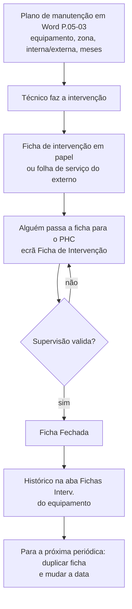

# Circuito de manutenção atual no PHC (Landeiro)

Fonte: ecrã partilhado na reunião de 04/11/2026 (PHC Evolution (Ultimate) 2025.04, base LAND2, empresa Carnes Landeiro). Imagens em `fontes/video-frames/`. Só leitura: o que está aqui foi visto no vídeo, não na base de dados. A estrutura real das tabelas é a primeira tarefa da Parte 1 (levantamento).

## 1. Onde fica

Opções Internas → Manutenção → **Infraestruturas** (ecrã 1). A partir dele abre-se a **Ficha de Intervenção** (ecrã 3, duplo clique na linha da aba Fichas Interv.).

## 2. Ecrã "Infraestruturas" (equipamento)

| Aba | O que mostra (visto no vídeo) |
|---|---|
| Dados principais | Nº Infraestrutura, Descrição, Nº Série, Obsoleto?, Tipo (Equip. Produção, Veículos), Marca, Modelo, Matrícula, Data, Localização (Abate de Suínos, Salsicharia), Ano de Aquisição, Email Envio de Alerta, Fornecedor (nome e nº), Valor de Aquisição, Marcada |
| Outros Dados | não mostrada |
| Instr. Manut. | instruções de manutenção do equipamento (referida na conversa, não mostrada) |
| Fichas Interv. | grelha: Data, Número, Tipo Manutenção, Tipo Intervenção, Problema, Obsoleto |
| Via Verde | específica de viaturas, não mostrada |
| Histórico Status | não mostrada |

Exemplos: 79 Depiladora Suínos (marca Mecanipol, localização Abate de Suínos, fornecedor Mecanipol); 248 Enchedora REX Tecnologie 460 (Equip. Produção, Salsicharia, 2018, fornecedor Vaessen-Schoemaker Portugal). A lista de tabelas do utilizador do ecrã mostra "Etiquetadora Bizerba GLP 160", "BF-29-GG" (veículo) e "Depiladora Suínos".

## 3. Ecrã "Ficha de Intervenção"

Cabeçalho: **Supervisão?** (desativado para o operador), **Fechada?**, **Obsoleto?**. Abas: Dados principais, Movimentos Internos, Movimentos Externos.

| Campo | Notas |
|---|---|
| Infraestrutura | nº e descrição do equipamento |
| Periodicidade | lista: De acordo com procedimento, Diária, Mensal, Quinzenal, Regular, Semanal, Semestral, Sempre que necessário |
| Ficha nº e Data | a data é a da intervenção (pré-preenchida com a de hoje) |
| Tipo Manutenção | Interna ou Externa |
| Tipo Intervenção | Preventiva ou Curativa |
| Doc. Externo / Folha Serviço | nº da folha de obra do fornecedor externo |
| Kms, Revisão?, Horas Frio | campos de viaturas e frio |
| Anomalia/problema | texto livre |
| Intervenção | texto livre (exemplo: "Adição de óleo no lubrificador do ar comprimido verificação") |
| Limpeza Local / Remoção Utensílios? | caixa de seleção |
| Fornecedor | nome e nº (intervenções externas) |
| Mão de Obra, Materiais/Peças, Total Ficha Intervenção | valores calculados (0,000 nos exemplos) |
| Marcada | campo standard PHC |

**CONFIRMADA (2026-11-06, ver `base-landeiromaui.md`): "peças usadas numa intervenção" existe em `u_matinterv`.** Hipótese original: as abas Movimentos Internos/Externos guardam as peças e custos (Mão de Obra e Materiais/Peças somam deles). Se for verdade, a ligação "peças usadas numa intervenção" já existe e deve ser reaproveitada em vez de criar tabela nova.

## 4. Fluxo atual (como é feito hoje)

Dores identificadas: duplo registo (papel e PHC), sem alertas, sem visão do que está planeado ou atrasado, sem controlo de peças (consumos, stock, rutura), planeamento só no Word.

## 5. Plano de manutenção em Word (P.05-03 v1.4, 2026)

Tabela com: Nº (igual ao nº da infraestrutura), Designação, Zona (Abate, Salsicharia…), Entidade (Interna, Externa ou Interna/Ext), colunas JAN a DEZ com "x" nos meses planeados e a periodicidade resumida (Mensal, Trimestral…). Equipamentos a vermelho = **Suposição:** novos ou ainda sem plano concluído. O ficheiro vai ser enviado pelo Luís e é a entrada do planeamento das preventivas (Parte 1).
