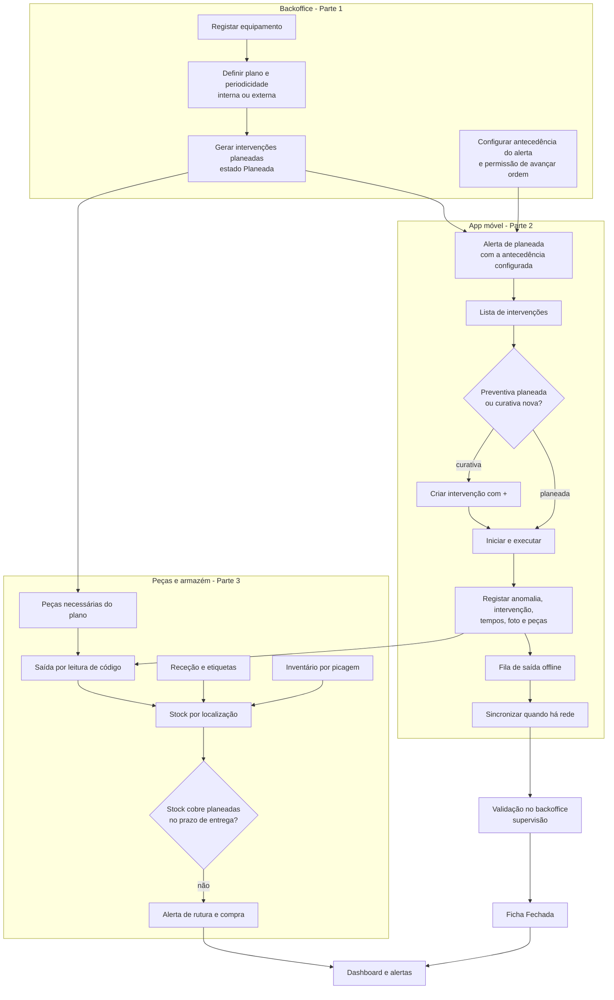
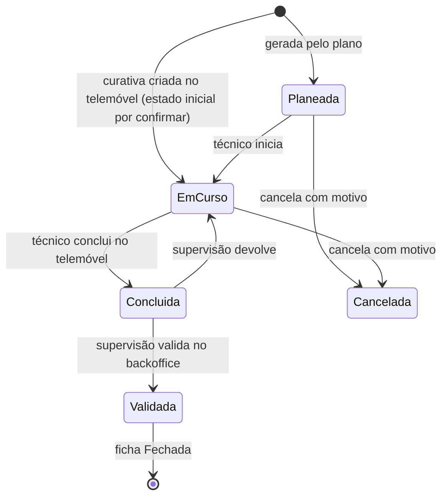
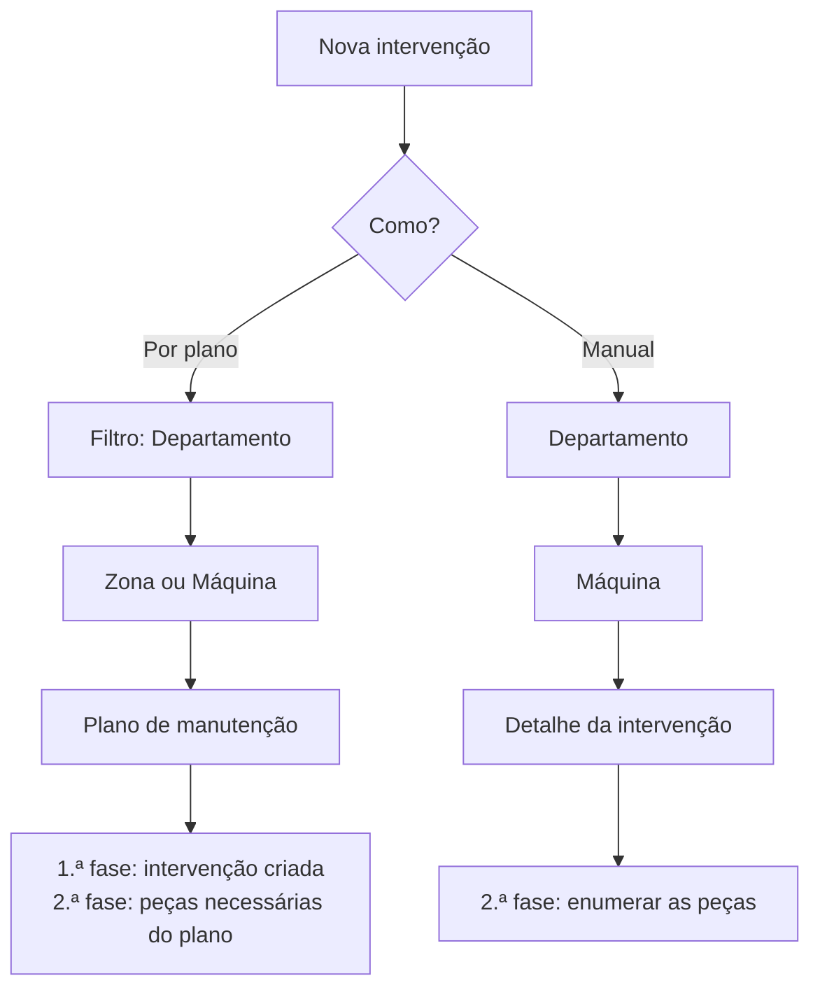
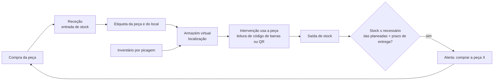
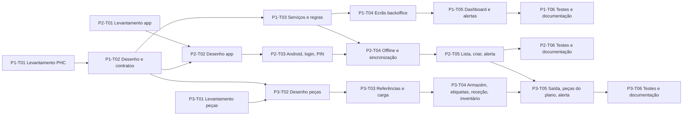

# Fluxogramas gerais do circuito alvo

Diagramas em Mermaid (abrem no VS Code com a extensão Markdown Mermaid, no GitHub e no Azure DevOps).

## 1. Circuito ponta a ponta (alvo)

## 2. Estados de uma intervenção

Derivados, nunca gravados (base LandeiroMaui, `base-landeiromaui.md`): **Atrasada** (Planeada/EmCurso com data < hoje) e **A vencer** (Planeada com data até hoje + antecedência). Estado vazio = ficha antiga (legado).

## 3. Criação de uma intervenção (quadro 1)

## 4. Peças: compra, receção, consumo, alerta

## 5. Sequência de execução do planeamento

