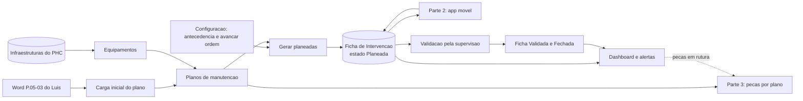
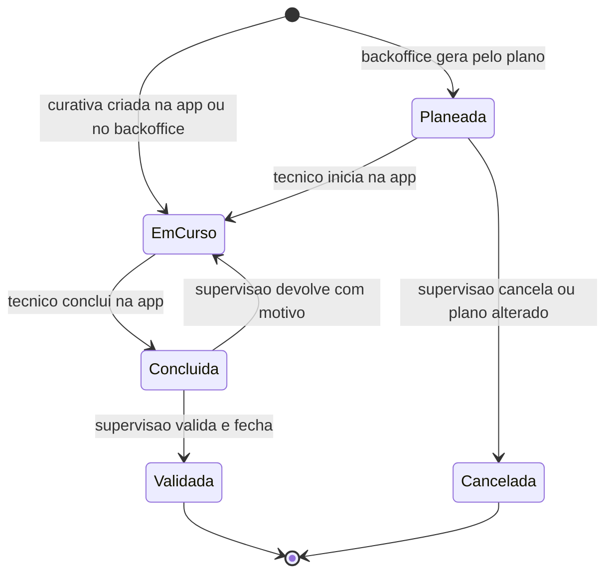
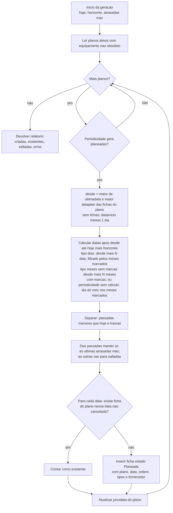
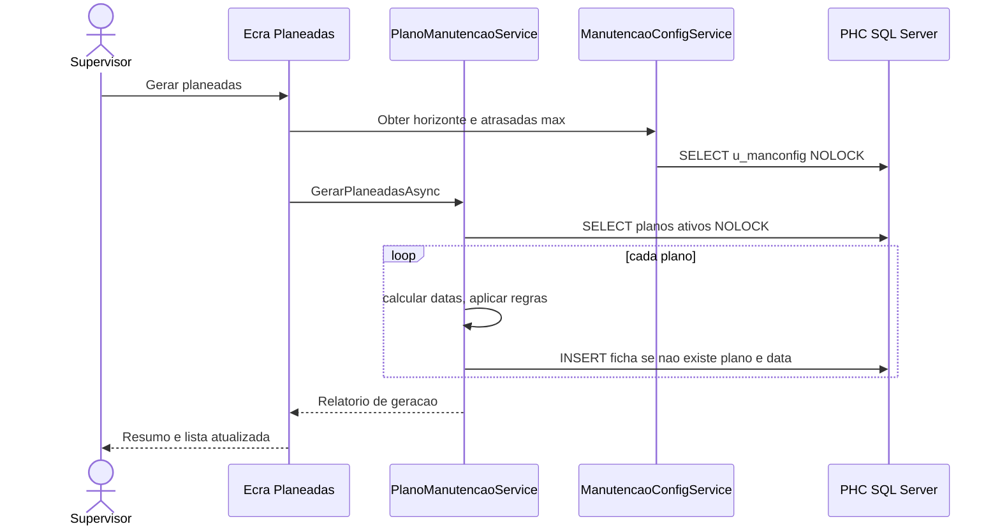
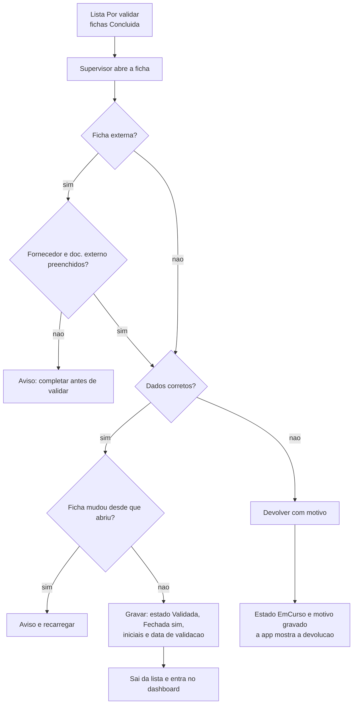
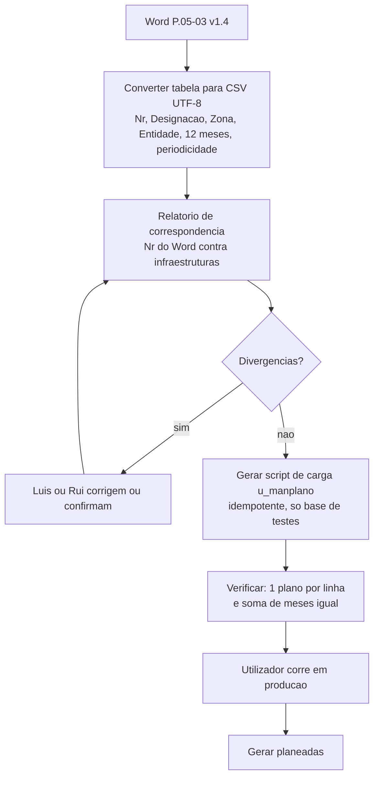
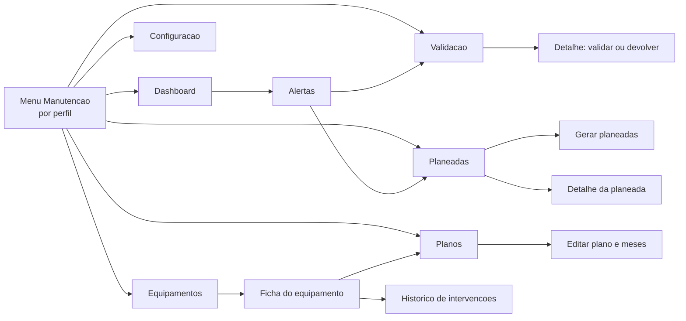
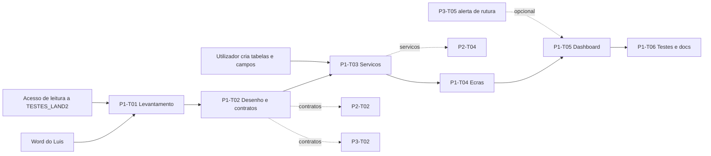

# Parte 1 (Backoffice e PHC): fluxogramas

Mermaid (abre no VS Code com a extensão Markdown Mermaid, no GitHub e no Azure DevOps). Nomes de tabelas e campos são candidatos até P1-T01.

## 1. Visão da Parte 1 e interfaces com as outras partes

## 2. Estados da intervenção e quem muda cada transição

Derivados (não gravados): Atrasada = `Planeada` ou `EmCurso` com data planeada anterior a hoje; A vencer = `Planeada` dentro da antecedência.

## 3. Algoritmo de geração das planeadas (BO-03)

Regras de datas: dia do mês limitado ao último dia do mês (31 em fevereiro = 28 ou 29); só datas, sem horas; `meses` vazio = todos os meses; no máximo 24 ocorrências por plano e por execução (travão). Um erro num plano é registado (`CrashLogService`), vai para o relatório e a geração continua nos outros.

## 4. Sequência: gerar planeadas a partir do ecrã

## 5. Validação pela supervisão (BO-06)

## 6. Carga inicial do plano (BO-09)

## 7. Navegação dos ecrãs do backoffice

## 8. Sequência de execução das tasks da Parte 1 e dependências externas

