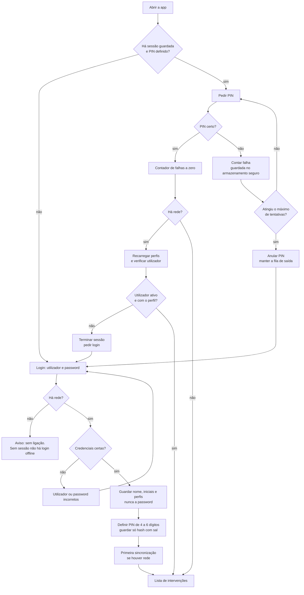
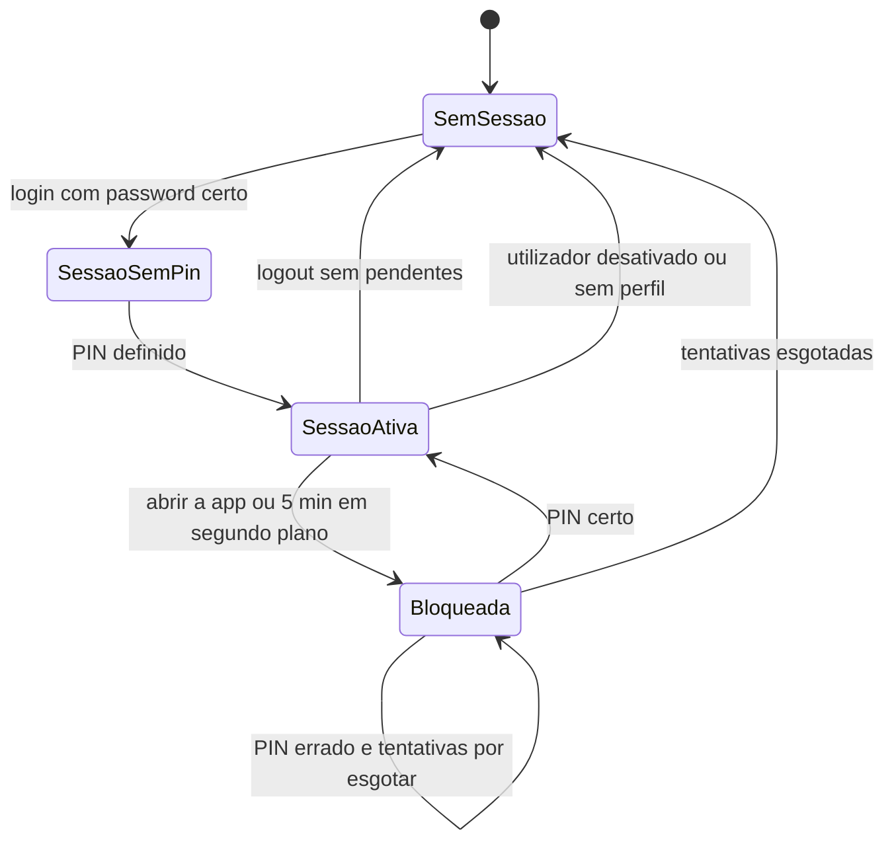
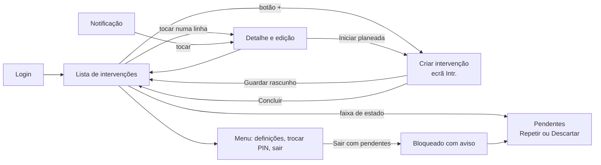
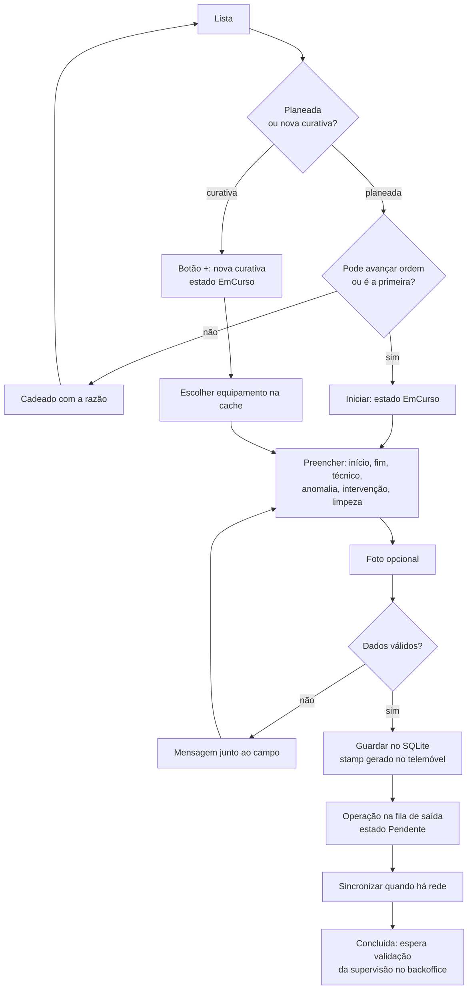
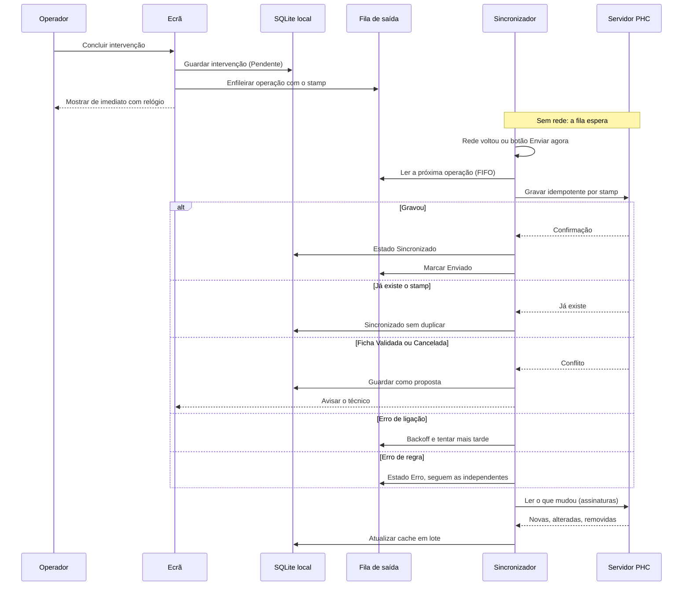
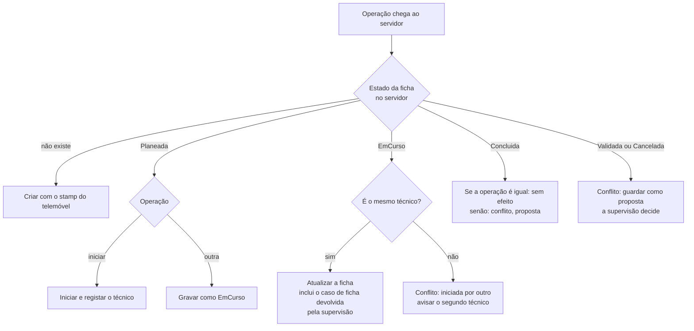
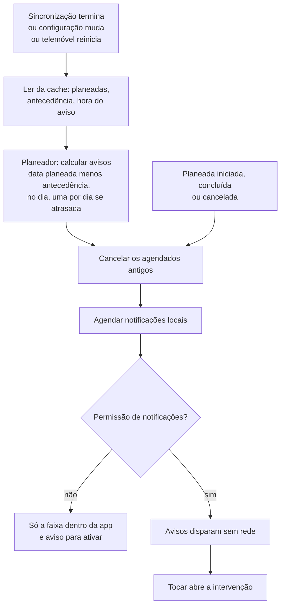
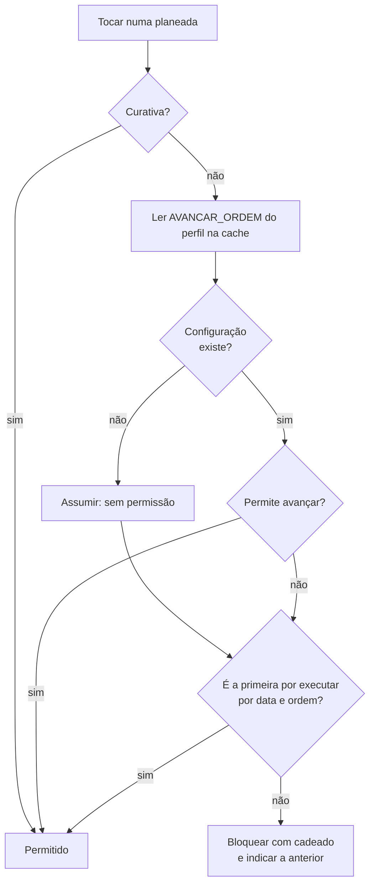
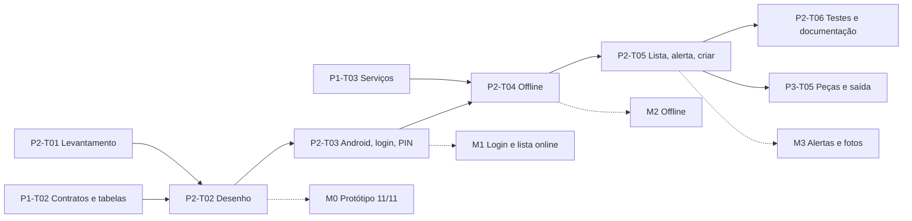

# Parte 2: fluxogramas da app de intervenções

Diagramas em Mermaid (abrem no VS Code com a extensão Markdown Mermaid, no GitHub e no Azure DevOps). Coerentes com `00-Comum/fluxogramas-gerais.md`. Nomes de campos e tabelas são provisórios até P1-T02.

## 1. Entrada na app (login, PIN e sessão)

## 2. Estados do PIN e da sessão

## 3. Navegação entre ecrãs

## 4. Registo de uma intervenção no telemóvel

## 5. Gravação offline e sincronização (sequência)

## 6. Conflitos (ganha a validação do backoffice)

## 7. Alerta de intervenções planeadas

## 8. Avançar ordem (APP-06)

## 9. Dependências da Parte 2 com as outras partes e marcos

