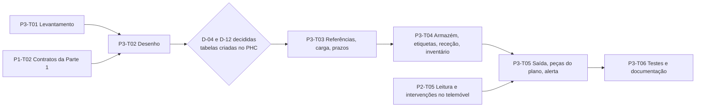

# Parte 3: Peças e armazém

Gestor de Manutenção · Carnes Landeiro · Planeamento criado em 05/11/2026 · Estado: rascunho, nenhuma task arrancou.

## 1. O que a parte faz

Dá à Landeiro o que hoje não tem: referências e stock das peças de manutenção, ligados aos planos e às intervenções. Cobre PEC-01 a PEC-10 de `../00-Comum/requisitos-gerais.md`:

- referências das peças no PHC (família própria, recomendado) ou em ambiente separado, com referência interna hierárquica e do fabricante, designação original em inglês e tradução (D-04);
- carga das peças por máquina a partir do PDF Marel, com IA, tradução e validação humana;
- peças necessárias por plano e por intervenção (plano → equipamento → peças) e tempo de entrega por artigo e fornecedor;
- armazém virtual (localizações), etiquetas da peça e do local, receção, inventário por picagem e saída por leitura de código de barras ou QR;
- alerta de rutura: planeadas vs stock vs tempo de entrega.

Fluxo: compra → receção → etiqueta e localização → saída por leitura na intervenção → alerta de rutura → compra.

## 2. Ficheiros desta pasta

| Ficheiro | Conteúdo |
|---|---|
| `requisitos.md` | PEC-01 a PEC-10 com regra, critérios de aceitação verificáveis, casos limite e perguntas; fórmula do alerta com casos de teste |
| `fluxogramas.md` | 10 diagramas Mermaid (visão geral, carga por IA, geração da referência, receção, saída offline, inventário, etiquetas, alerta, ecrãs) |
| `tarefas.md` | P3-T01 a P3-T06 em subtarefas, dependências, critérios e horas |
| `codificacao-pecas.md` | Esquema `M<MMM>-<CCC>.<PPP>`, localizações, conteúdo dos QR, resolução de leituras, tabela de validações |
| `carga-pecas-ia.md` | Pipeline de extração do PDF Marel, regra de privacidade, formato do ficheiro de importação, validações |
| `mockups/armazem-e-etiquetas.html` | Mockup clicável de ficheiro único (peças por máquina, receção, saída por leitura, inventário, desenho das etiquetas, alertas), marca SigmaCode, dados fictícios |
| `prompts/00-prompt-mestre.md` | Prompt de projeto grande da parte (Fase 0 de orçamentação e fases 1 a 6) |
| `prompts/01` a `06` | Um prompt por task (nomes de `00-global.md`); o 01 está pronto a usar, os 02 a 06 são rascunho 0.1 |

## 3. Ordem de execução e dependências

- **P3-T01** precisa do acesso de leitura à base de testes (pendência 2) e, para o PDF, da autorização D-11.
- **P3-T02** precisa de **P1-T02** (contratos e modelo da Parte 1) e da resposta sobre quem recebe as peças (pendência 7).
- **P3-T03** precisa de **D-04 decidida** e das tabelas criadas no PHC por pessoas (risco R-02).
- **P3-T05** precisa de **P2-T05** para a leitura por câmara e o inventário no telemóvel; a parte Windows não precisa e avança.
- A Parte 3 devolve à Parte 1 o feed do alerta (dashboard, BO-07) e à Parte 2 o contrato de peças da intervenção (APP-08).

## 4. Quem faz o quê

| Quem | O quê |
|---|---|
| Utilizador | Decide D-04, D-11 e D-12; fornece o acesso de leitura; confirma cada gate |
| Landeiro | PDF Marel (pendência 8), autorização D-11, criação das tabelas ou quem as cria, validação das peças (1.ª máquina inteira), quem recebe as peças, impressora e rolo de etiquetas |
| Osvaldo / SigmaCode | Carga com IA (extração, glossário), acompanha a validação, cria tabelas se acordado |
| Claude Code (agentes) | Levantamento só leitura, desenho, código e testes no LandeiroMaui, documentação; nunca cria tabelas nem campos |

## 5. Como arrancar

1. Responde às perguntas que bloqueiam (secção 8) e fornece o acesso de leitura à base de testes.
2. Copia o `../00-Comum/00-global.md` para `docs/tasks/` do repositório de código e coloca `prompts/` onde o Claude Code os leia.
3. Arranca com `prompts/00-prompt-mestre.md` (Fase 0: orçamento, responde `APROVADO`) ou, para correr só o levantamento já, com `prompts/01-levantamento.md`. Os levantamentos das três partes podem correr ao mesmo tempo.
4. Cada task fecha com um gate teu; as tasks 02 a 06 revêem-se quando a anterior fechar.

Estimativa de esforço da parte (planeamento, a rever depois de P3-T02): 108 a 174 horas (ver `tarefas.md`).

## 6. Riscos específicos desta parte (além dos de `00-global.md`)

| # | Risco | Mitigação |
|---|---|---|
| P3-R1 | Criar artigos no PHC por código pode falhar (campos obrigatórios, triggers) ou partir regras | O levantamento descreve como se cria; o desenho escolhe importação nativa do PHC ou INSERT só na base de testes com validação da Landeiro |
| P3-R2 | PDF sem camada de texto (imagem) | OCR local ou pedir versão pesquisável; bloqueia a carga, não o resto |
| P3-R3 | Texto do PDF enviado ao modelo de IA sem autorização | D-11; extração local por defeito; manifesto regista o que foi enviado |
| P3-R4 | Mesma peça em vários conjuntos fragmentaria o stock | D-12: um artigo por código do fabricante, ligações por posição |
| P3-R5 | Saída offline que deixa stock negativo | Nunca recusada; assinala-se e o inventário corrige |
| P3-R6 | Alerta só vê planeadas já geradas como fichas | Documentado; a Parte 1 gera à frente pela janela de antecedência |

## 7. Pressupostos novos (Suposição, não estão em `00-global.md`)

1. **Decisões novas:** D-11 (autorização para tratar o PDF Marel com serviços externos) e D-12 (um artigo por código do fabricante). Ambas por tomar.
2. Referência interna `M<MMM>-<CCC>.<PPP>` com 3 dígitos por nível e prefixo `M`; subconjuntos do manual achatam-se no conjunto; localização `<Z><EE>-
-<PP>` e `RECEC`; payloads `PEC:` e `LOC:` (QR e Code 128).
3. Tabelas novas além das do `arquitetura-e-modelo-de-dados.md`: `u_manmaq`, `u_manconj`, `u_manmovloc` (substitui `u_manintpec` se os Movimentos da ficha não servirem), `u_maninv`, `u_maninvlin`; campos novos em `u_manpeca` (`codbarras`, `idiomaorig`, `locdefeito`, `conjunto`) e em `u_manpecaequip` (`conjunto`, `itemno`).
4. Prazo de entrega: dias de calendário; efetivo = o mais longo entre par artigo+fornecedor, artigo e fornecedor; `u_manlead` com `ref` vazio = por fornecedor e `fornecedor` 0 = por artigo.
5. Alerta: margem 7 dias, prazo por defeito 30 dias, necessidade inclui planeadas atrasadas, reservas = o previsto ainda não saído das EmCurso, encomendas em trânsito fora da v1 (parâmetro previsto), painel e contador no menu (e-mail fora da v1).
6. Movimentos de armazém: um movimento = uma linha com `opid` único (anti-duplicação offline); saída offline nunca recusada; estorno até a ficha ser Validada.
7. Receção só no backoffice na v1; etiquetas só impressas no Windows; etiqueta 60 × 40 mm a 203 dpi.
8. Etiquetas pelo editor de modelos existente no LandeiroMaui (`Services/Etiquetas`) com dois contextos novos; a leitura no Windows é por leitor tipo teclado (já existe) e por câmara no Android (nova, depende de P2-T05).
9. Ferramenta de extração separada da app, em `C:\_SigmaRepos\GestorManutencao\ferramentas\carga-pecas\` (Python com biblioteca permissiva ou .NET, decide-se em P3-T02).
10. Documentos das tasks em `docs/pecas-armazem/` do repositório de código (ver contradição 2).
11. Alvos de desempenho: leitura resolvida em menos de 500 ms com 4.000 peças; alerta em menos de 3 s com 4.000 peças e 500 planeadas; meta de 98% de linhas corretas na amostra de 20 páginas.
12. Esforço em horas de `tarefas.md`.

## 8. Contradições encontradas (segui a norma)

1. R-04 diz "3.300 a 4.000 referências **por máquina**"; o resumo da reunião diz 3.300 a 4.000 peças no total (só o Midas cerca de 300). A codificação suporta 999 × 999 por máquina, por isso não muda o desenho; confirmar a ordem de grandeza na amostra do PDF.
2. `00-global.md` fixa `docs/levantamento.md` e `docs/desenho.md` como saída das três partes (colidem no mesmo repositório). Nesta parte uso `docs/pecas-armazem/`.
3. `00-global.md` fala em branch por parte (`dev-landeiro-manutencao-p3`), mas o bloco `<environment>` comum diz que no LandeiroMaui não se fazem branches, commits nem push. Segui o bloco comum (só edição de ficheiros).
4. O brief diz que o Claude Code "processa localmente" o PDF; na prática o texto que lê é enviado ao modelo, o que conta como serviço externo. Por isso a D-11 e o modo sem IA.
5. A arquitetura prevê `u_manintpec` para o consumo; o desenho pode precisar de `u_manmovloc` (movimentos com rasto e `opid`). Resolve-se em P3-T02.

## 9. Perguntas que bloqueiam

| # | Pergunta | Dono | Bloqueia |
|---|---|---|---|
| 1 | D-04: referências no PHC com família própria (recomendado) ou ambiente separado? | Utilizador | P3-T03 |
| 2 | D-11: posso abrir páginas do PDF Marel e usar IA em nuvem (incluindo o Claude Code) para extrair e traduzir? Até onde (amostra, só designações)? | Utilizador / Landeiro | P3-T01 (parte do PDF) e carga |
| 3 | D-12: um artigo por código do fabricante (recomendado) ou um por posição? | Utilizador | P3-T02 |
| 4 | É possível criar tabelas e campos `u_` neste PHC e quem os cria? | Utilizador / Landeiro | P3-T03 |
| 5 | Quem dá entrada das peças (Compras ou manutenção) e como entra no stock PHC? | Landeiro | P3-T02 |
| 6 | O PDF Marel (350 MB) está disponível à SigmaCode e é pesquisável? | Osvaldo / Landeiro | P3-T01 (PDF) |
| 7 | Modelos de telemóvel, câmara e impressora/rolo de etiquetas | Landeiro | P3-T05 (telemóvel), etiquetas |

MELHORIA: o levantamento inicial de cada parte deve incluir a pergunta "que conteúdo do cliente vai para serviços de IA externos" antes de planear qualquer uso de IA sobre documentos do cliente.
