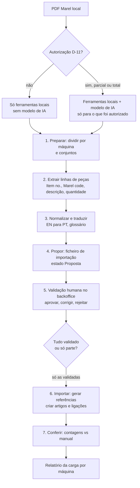

# Carga das peças a partir do manual Marel (pipeline com IA e validação humana)

Estado: proposta de planeamento (Parte 3, requisito PEC-02, risco R-04). Os formatos do PDF só se conhecem depois da amostra (P3-T01). A SigmaCode (Osvaldo) quer usar IA para separar as peças por máquina e traduzir; a Landeiro quer manter a designação original em inglês com a tradução ao lado.

## 1. Regra de privacidade (antes de tudo)

O PDF "Slaughterline Renovation" (cerca de 350 MB, propriedade do fabricante, enviado pela Landeiro) e os dados dele extraídos **não vão para serviços externos sem autorização expressa**. Atenção ao que "local" quer dizer:

- Ferramentas de extração que correm na máquina (leitura de texto do PDF, divisão por máquina, análise de tabelas) não enviam nada para fora.
- O Claude Code corre localmente, **mas o texto que ele lê (excertos do PDF, linhas extraídas) é enviado ao modelo para ser processado**. Isso conta como serviço externo. O mesmo vale para qualquer outro modelo de IA em nuvem.
- Por isso a autorização (decisão D-11, nova, por tomar) tem de dizer: quem autoriza (Landeiro e SigmaCode), que conteúdo (amostra de páginas, só as linhas de peças, só as designações a traduzir), para que modelo/serviço e durante quanto tempo, e se o manual tem restrições de confidencialidade ou direitos de autor.
- Sem autorização: extração só com ferramentas locais determinísticas; tradução por glossário técnico local (ficheiro editável) e por revisão humana; o agente não abre as páginas do PDF. Com autorização parcial (por exemplo só designações curtas): o ficheiro enviado ao modelo leva só as colunas autorizadas, nunca nomes de pessoas, preços nem dados da Landeiro.
- O que for decidido regista-se no `00-global.md` (decisões) e cada execução da tradução por IA grava no manifesto (secção 5) o que foi enviado e quando.

## 2. Pipeline



| Etapa | Entrada | Saída | Quem executa | Pode usar IA? |
|---|---|---|---|---|
| 1. Preparar | PDF completo | PDF (ou páginas) por máquina e índice de conjuntos | ferramenta local, uma vez | não (só se o PDF for imagem e precisar de OCR local) |
| 2. Extrair | PDF por máquina | linhas brutas (página, figura, item, código, descrição, quantidade) | ferramenta local; IA só para layouts que as regras não leem, e só se autorizado | opcional |
| 3. Normalizar e traduzir | linhas brutas | designação original limpa, idioma detetado, tradução PT | glossário local e, se autorizado, modelo de IA para o que o glossário não cobre | opcional |
| 4. Propor | linhas normalizadas | ficheiro de importação (secção 4) com estado `Proposta` e confiança | ferramenta local | não |
| 5. Validar | ficheiro de proposta | ficheiro com estado `Validada` ou `Rejeitada` (ou validação direta na grelha) | humano (Landeiro ou SigmaCode) | não |
| 6. Importar | linhas `Validada` | peças, ligações e conjuntos criados; referências geradas | app/backoffice (regras de `codificacao-pecas.md`) | não |
| 7. Conferir | manifesto + base | relatório: linhas do manual vs peças criadas, rejeitadas, duplicados | app | não |

Princípios: uma máquina de cada vez (as listas têm centenas de linhas por máquina); a importação é idempotente (reimportar o mesmo ficheiro não duplica); nada entra na base sem passar pelo estado `Validada`.

## 3. Extração do PDF (o que se espera encontrar)

Estrutura provável (a confirmar na amostra de P3-T01): capítulo por máquina, secções por conjunto com uma figura (explodido) e uma tabela de peças com colunas "Item no.", "Marel code" (código do fabricante, começa por 7 ou 5 nos exemplos ditos), descrição em inglês (por vezes português) e quantidade. Casos a tratar:

1. PDF sem camada de texto (imagem): exige OCR local; se não houver OCR local aceitável, o PDF pede-se ao fabricante/Landeiro em versão pesquisável (bloqueia a Parte 3 por R-04).
2. Linhas de descrição partidas em duas linhas; células vazias; "Item no." repetido ou com letras (`1a`).
3. Quantidades "AR" (as required) ou texto: ficam sem quantidade numérica e a validação humana decide (por defeito 1, marcado).
4. Mesmo código em vários conjuntos: uma peça, várias ligações (regra 4 de `codificacao-pecas.md`).
5. Códigos com zeros à esquerda ou hífenes: guardar sempre como texto.
6. Páginas de índice, avisos, conjuntos sem peças: ignoradas e listadas no relatório.
7. Designações misturadas (inglês e português na mesma linha): idioma por linha; o original guarda-se tal como está.

Ferramenta de extração (Suposição, decidir em P3-T02): programa de linha de comandos único, fora da app MAUI, em Python com biblioteca de leitura de PDF de licença permissiva (por exemplo pdfplumber, MIT) ou em .NET (por exemplo PdfPig, Apache-2.0). Critérios: lê tabelas sem camada gráfica, corre em páginas isoladas (memória baixa para 350 MB), testável. Não usar bibliotecas com licença que obrigue a abrir o código sem registar no `docs/DEPENDENCIES.md`.

## 4. Formato do ficheiro de importação

CSV UTF-8 com BOM, separador `;`, cabeçalho na primeira linha, decimal com ponto, uma linha por (conjunto, peça) do manual. Um ficheiro por máquina. Texto sempre entre aspas se tiver `;`.

| # | Coluna | Obrigatória | Descrição e regra |
|---|---|---|---|
| 1 | `maquina_cod` | sim | `M001`; deve existir no catálogo de máquinas |
| 2 | `maquina_desc` | sim | Nome da máquina (para criar no catálogo se for nova, com confirmação) |
| 3 | `conjunto_cod` | não | Vazio na proposta: a app atribui (`M001-003`); preenchido em reimportações |
| 4 | `conjunto_seq` | sim | Ordem do conjunto no manual (1, 2, 3…) |
| 5 | `conjunto_desigen` | sim | Título do conjunto em inglês (original) |
| 6 | `conjunto_desigpt` | sim | Tradução PT |
| 7 | `pagina` | sim | Página do PDF (rasto para conferência) |
| 8 | `figura` | não | Número da figura/desenho |
| 9 | `item_no` | sim | Valor de "Item no." como texto |
| 10 | `reffabric` | sim | "Marel code" como texto, normalizado |
| 11 | `fabricante` | sim | `Marel` (por defeito) |
| 12 | `desigen` | sim* | Designação original em inglês; vazia se o original era português |
| 13 | `desigpt` | sim | Tradução PT (ou o original se já era português) |
| 14 | `idiomaorig` | sim | `EN`, `PT` ou `XX` |
| 15 | `qtt` | sim | Quantidade montada por máquina (decimal; `1` se "AR", com `obs` a dizer) |
| 16 | `unidade` | não | Un. por defeito |
| 17 | `confianca` | sim | 0 a 100: certeza da extração/tradução (para ordenar a validação humana) |
| 18 | `estado` | sim | `Proposta` (saída da ferramenta), `Validada` ou `Rejeitada` |
| 19 | `obs` | não | Notas do extrator ou do validador (até 100 caracteres) |

Exemplo (fictício):

```
maquina_cod;maquina_desc;conjunto_cod;conjunto_seq;conjunto_desigen;conjunto_desigpt;pagina;figura;item_no;reffabric;fabricante;desigen;desigpt;idiomaorig;qtt;unidade;confianca;estado;obs
M001;Midas;;1;Cutting head;Cabeça de corte;12;3.1;1;7000123;Marel;Cutting blade;Lâmina de corte;EN;2;Un.;96;Proposta;
M001;Midas;;1;Cutting head;Cabeça de corte;12;3.1;2;7000124;Marel;Blade holder, left;Suporte da lâmina, esquerdo;EN;1;Un.;93;Proposta;
M001;Midas;;2;Transmission;Transmissão;14;3.2;1;5000456;Marel;O-ring 32x3;Anel O 32x3;EN;4;Un.;88;Proposta;qtd lida da coluna Qty
```

**Manifesto** (`<ficheiro>.manifesto.json`, ao lado do CSV): nome e tamanho do PDF e o seu hash SHA-256 (nunca o conteúdo), intervalo de páginas, data, versão da ferramenta, configuração (glossário e sua versão), se houve IA (serviço e modelo, só nome genérico; que colunas foram enviadas; quando) e totais (linhas lidas, propostas, descartadas). Sem caminhos de rede, nomes de pessoas nem credenciais.

## 5. Validações automáticas (antes e depois da validação humana)

| # | Validação | Falha = |
|---|---|---|
| V1 | Colunas obrigatórias preenchidas e `estado` válido | linha rejeitada na importação, com motivo |
| V2 | `reffabric` não vazio, sem espaços nas pontas, tratado como texto | erro |
| V3 | `qtt` > 0 e ≤ um máximo configurável (por defeito 1000) | aviso, vai para revisão humana |
| V4 | Duplicado no mesmo ficheiro: mesmo conjunto e mesmo `item_no` com `reffabric` diferente | erro |
| V5 | Mesmo `reffabric` com `desigen` muito diferente em linhas distintas | aviso (provável erro de leitura) |
| V6 | Designação PT vazia ou igual ao original em inglês sem justificação | aviso |
| V7 | Contagem de linhas por conjunto vs linhas do manual (secção 7) | relatório de conferência |
| V8 | Importar só `Validada`; as `Proposta` nunca entram | bloqueio |
| V9 | Idempotência: (`maquina_cod`, `reffabric`) existente → só atualiza designação se o campo não foi editado à mão | regra |

## 6. Validação humana

Ecrã no backoffice (Windows) com a grelha de linhas por máquina e conjunto, ordenável por `confianca` crescente: corrigir `desigpt`, `qtt`, `reffabric`, juntar conjuntos, aprovar linha, aprovar todas as acima de um limiar (por defeito 95, configurável) **depois de uma amostra aprovada**, rejeitar com motivo. Regras: a validação regista quem e quando (iniciais); a primeira máquina valida-se por inteiro (para calibrar a extração); nas seguintes, 100% das linhas com `confianca` abaixo do limiar e uma amostra aleatória (por defeito 10%) das restantes. Meta de aceitação da extração: pelo menos 98% das linhas da amostra de 20 páginas corretas em código e quantidade (Suposição, a confirmar com a Landeiro).

## 7. Conferência

Por máquina: nº de linhas lidas, propostas, validadas, rejeitadas, peças novas, ligações novas, duplicados ligados a peças existentes; por conjunto: linhas do manual (contadas da tabela, não da IA) vs peças e ligações criadas; lista de páginas ignoradas. A carga só se dá por concluída quando as diferenças estão explicadas.

## 8. Divisão de trabalho

| Quem | O quê |
|---|---|
| Landeiro | disponibiliza o PDF (pendência 8), autoriza (D-11), valida as peças (a primeira máquina inteira) |
| Osvaldo / SigmaCode | corre a extração, afina o glossário, acompanha a validação |
| Claude Code (P3-T03) | escreve a ferramenta de extração, a importação e o ecrã de validação; só corre a extração sobre o PDF se D-11 o permitir |
