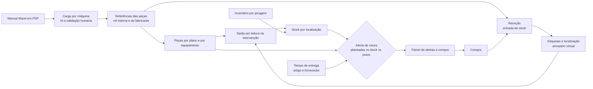
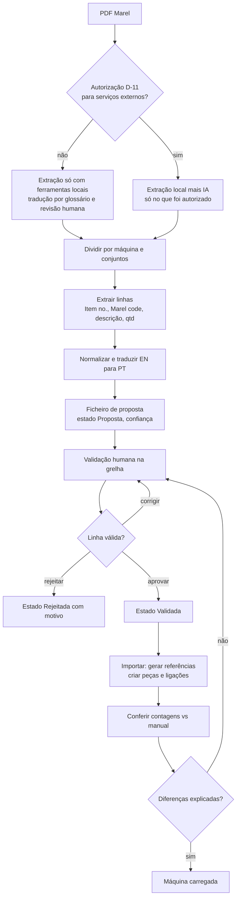
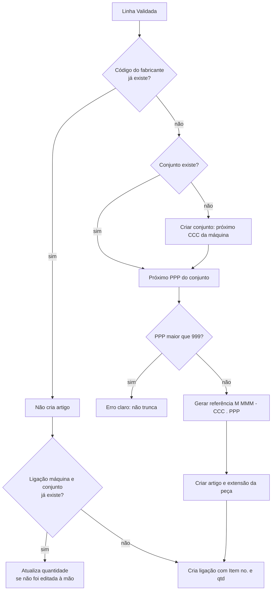
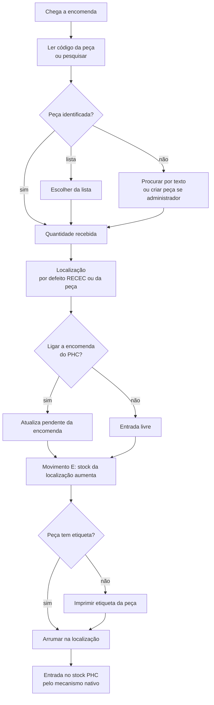
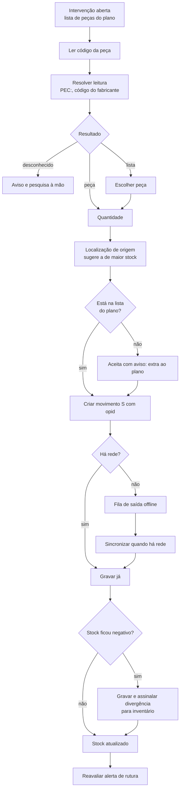
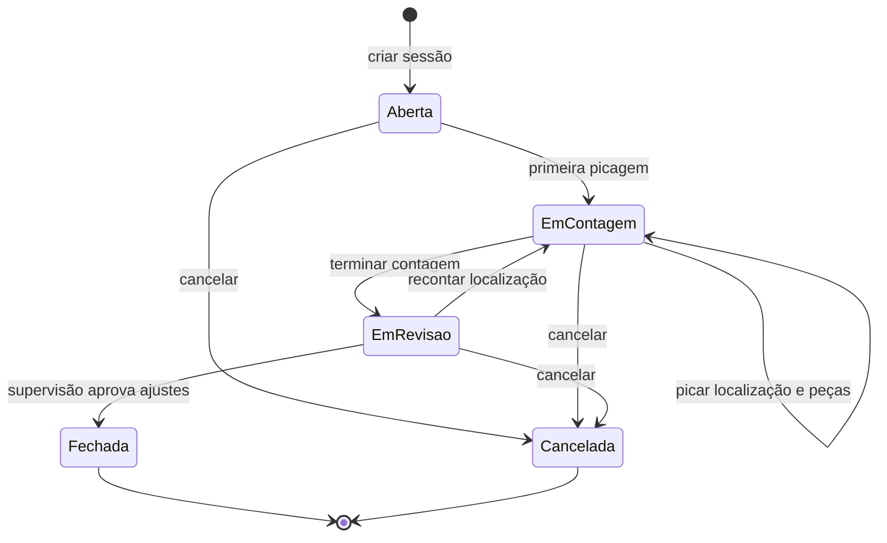
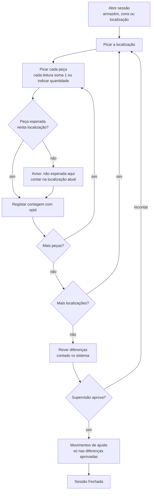
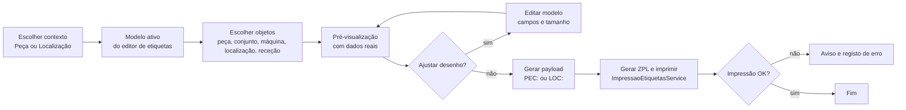
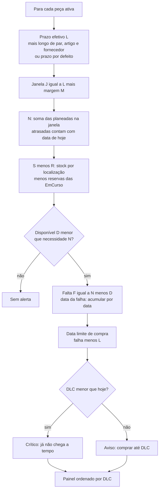
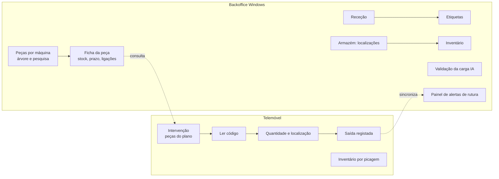

# Fluxogramas da Parte 3: Peças e armazém

Diagramas em Mermaid (abrem no VS Code com a extensão Markdown Mermaid, no GitHub e no Azure DevOps). Coerentes com `00-Comum/fluxogramas-gerais.md` (secções 1 e 4).

## 1. Visão geral da Parte 3

## 2. Carga das peças por IA (com portão de autorização)

## 3. Geração da referência interna na importação

## 4. Receção de peças

## 5. Saída por leitura (telemóvel, com offline)

## 6. Estados de uma sessão de inventário

## 7. Inventário por picagem (passos)

## 8. Etiquetas (criar e imprimir)

## 9. Cálculo do alerta de rutura (sequência)

## 10. Sequência de ecrãs do backoffice (Windows) e do telemóvel

