# Gestor de Manutenção — Documento de design (desktop e mobile)

Versão: 12/11/2026 · Estado: descreve a app como está hoje (branch `feature/redesign-tema-landeiro`)

## 1. Objetivo e princípios

Uma só app (.NET MAUI Blazor Hybrid, Windows e Android) usada por operadores no chão de fábrica, muitas vezes de pé, com luvas ou com pouca atenção, e por supervisores ao computador.

| Princípio | Como se vê na app |
|---|---|
| Uma tarefa por ecrã | Cada mosaico leva a uma só área; fichas e formulários curtos. |
| Alvos grandes | `--alvo: 52px` (mínimo de toque); teclado de PIN com teclas grandes. |
| Ler de relance | Contadores grandes no Início, cartões com a zona, o tipo e o prazo (**Hoje**, **Atrasada**). |
| Falar em vez de escrever | Botão **Falar** nos campos de texto longos. |
| Gravar sem procurar | Botão de gravar fixo em baixo (barra fixa) nas fichas e formulários. |
| Funcionar sem rede | Registos ficam **Por enviar** e seguem quando a rede volta. |
| Um tema por cliente | Cores, nome e logótipo vêm de um JSON; o layout é o mesmo. |

## 2. Identidade visual e temas

### 2.1 Tema por cliente

Os temas estão em `GestorManutencao.UI/Temas/*.json` (claro e escuro) e são aplicados como variáveis CSS (`TemaEstilo.razor`). O cliente da compilação é `landeiro` (`MauiProgram.cs`).

| Token | Claro | Escuro |
|---|---|---|
| `fundo` | `#F7F5F6` | `#110F1B` |
| `superficie` | `#FFFFFF` | `#1C1829` |
| `texto` | `#1A1731` | `#F4F1F2` |
| `texto-suave` | `#5B5870` | `#CFC8D0` |
| `primario` (Landeiro) | `#9E0B0F` | `#FF6B70` |
| `borda` | `#8A8A96` | `#9A94A6` |
| `erro` | `#B3261E` | `#FF9C94` |
| `foco` | `#1A1731` | `#FFB3B6` |

Cabeçalho (`marca-fundo`): gradiente de `#14111F` a `#4A1219`. O botão da lua alterna claro/escuro e respeita `prefers-color-scheme`.

O tema `sigmacode.json` usa a marca SigmaCode (verde `#5BB572`, azul `#3466AF`, roxo `#604696`, azul-escuro `#1A1731`, cinzento `#CAC9C9`). É o tema por defeito de trabalho interno; só se troca por outro cliente quando o pedido o indica.

Os testes (`GestorManutencao.Tests`) validam as chaves de cada tema e o contraste.

### 2.2 Tipografia

| Uso | Fonte | Variável |
|---|---|---|
| Títulos, números, botões | **Exo 2** | `--fonte-titulos` |
| Corpo e formulários | **Open Sans** | `--fonte-corpo` |

Ficheiros locais em `wwwroot/fonts` (a app não depende de fontes da internet). Alternativa de segurança: Segoe UI / `system-ui`.

### 2.3 Espaço, forma e profundidade

- Escala de espaços: 4 · 8 · 12 · 16 · 24 · 32 · 48 px (`--esp-1` a `--esp-7`).
- Raios: 12 px (campos, botões), 18–22 px (painéis e cartões), pílulas em chips (`--raio-chip`).
- Estilo plano e moderno: superfícies claras com sombra suave; barra de cor de 4 px à esquerda do cartão de ficha para o estado.
- O botão primário usa o gradiente do tema; a engrenagem decorativa do cabeçalho é gráfica e não interativa.
- Movimento reduzido: `prefers-reduced-motion` desliga animações.

## 3. Estrutura de navegação

### 3.1 Mapa de ecrãs

```
Entrar (PIN) ──► Mudar PIN (1.º acesso)
Início
├─ Operador:   Intervenções · Avaria · Máquinas · Avisos
│   ├─ /intervencoes      lista → /intervencoes/{id}
│   ├─ /avaria            registar avaria
│   └─ /equipamentos      lista → /equipamentos/{id}
└─ Supervisor: Planeadas · Validação · Máquinas · Mais · Avisos
    ├─ /planeadas  /validacao  /por-rever  /fichas  /nova-ficha
    ├─ /equipamentos/novo · /{id}/editar · /{id}/instrucoes → /instrucoes/{id}/tarefas
    └─ /mais → /periodicidades · /equipa · /configuracao
```

As áreas do supervisor mostram "Esta área é só para supervisores." a um operador.

### 3.2 Padrão por dispositivo

| | Desktop (≥ 900 px) | Telemóvel (< 900 px) |
|---|---|---|
| Navegação principal | Barra lateral à esquerda, com ícone e texto | Barra inferior de 72 px (`--nav-h`), ícone + texto curto |
| Cabeçalho | Logótipo, nome completo, lua, sair | Logótipo; no Início, lua e sair dentro do cartão de boas-vindas |
| Mosaicos do Início | 3 colunas (≥ 720 px) | 1 coluna |
| Contadores | Até 4 por linha | 2 por linha, mais compactos |
| Botão de criar | Mosaico "Nova ficha" no Início | Botão flutuante **+** nas listas |
| Gravar | Barra fixa no fundo da zona central | Barra fixa acima da barra inferior |
| Nome do utilizador | Sempre visível | Escondido abaixo de 520 px |

## 4. Design desktop

Resolução de referência: 1280 × 800.

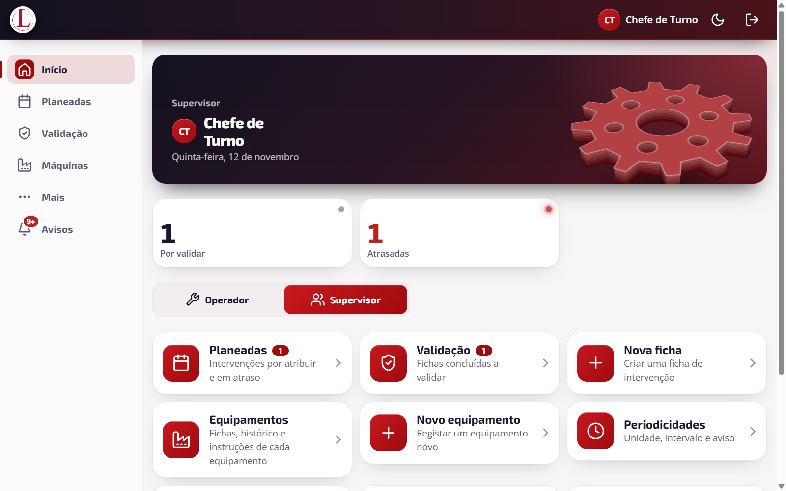

- **Cabeçalho** escuro com gradiente; menu lateral com o item ativo em cápsula (fundo rosado, ícone em quadrado primário e barra de realce à esquerda).
- **Cartão de boas-vindas** (`hero`) largo, com a engrenagem à direita.
- **Contadores** em cartões brancos com um ponto de estado (cinzento = informativo, vermelho = atenção).
- **Mosaicos** em grelha automática (`minmax(280px, 1fr)`), cada um com ícone em quadrado primário, título, descrição e seta; o contador surge como chip ao lado do título.

| Entrada | Lista de validação |
|---|---|
| 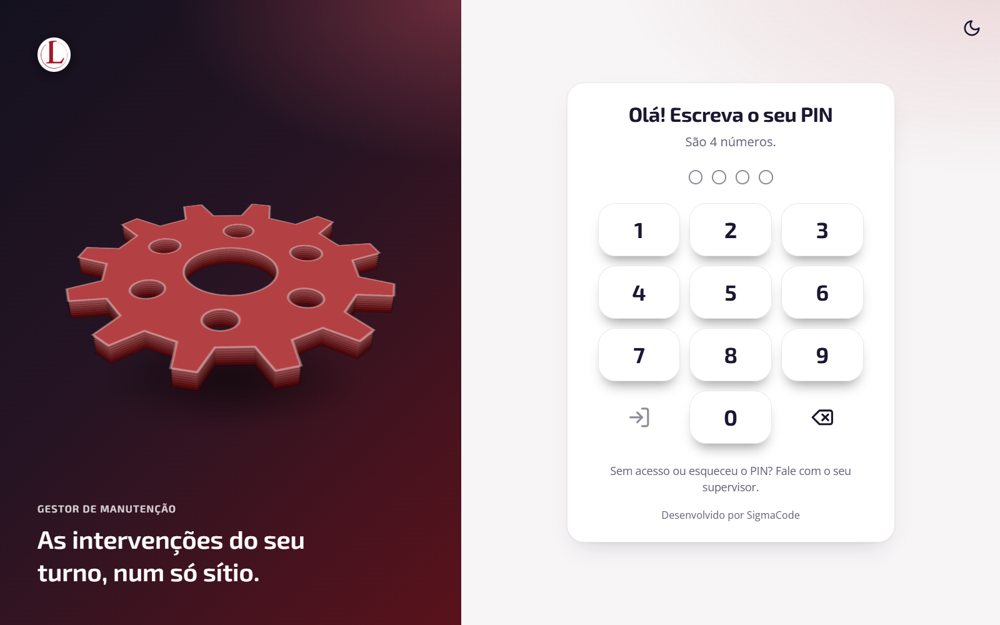 | 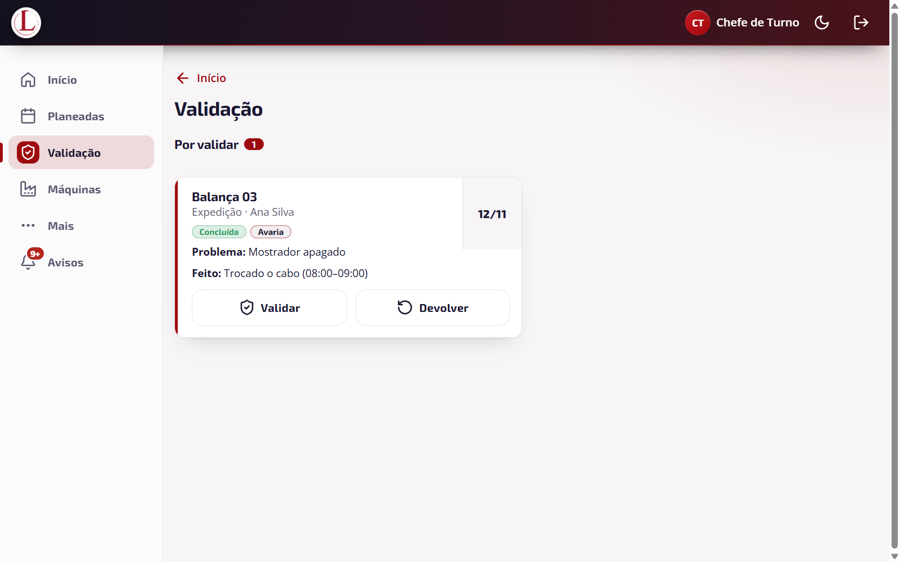 |

| Formulário (nova ficha) | Configuração |
|---|---|
| 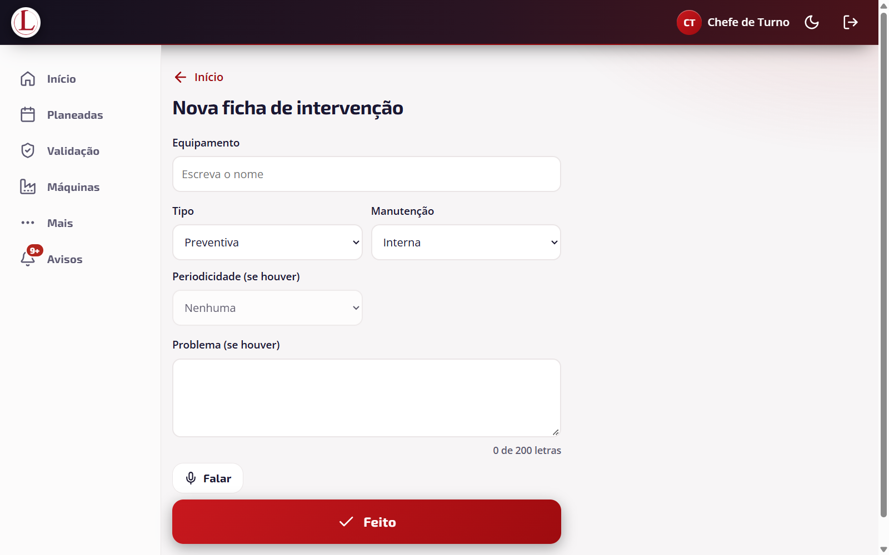 | 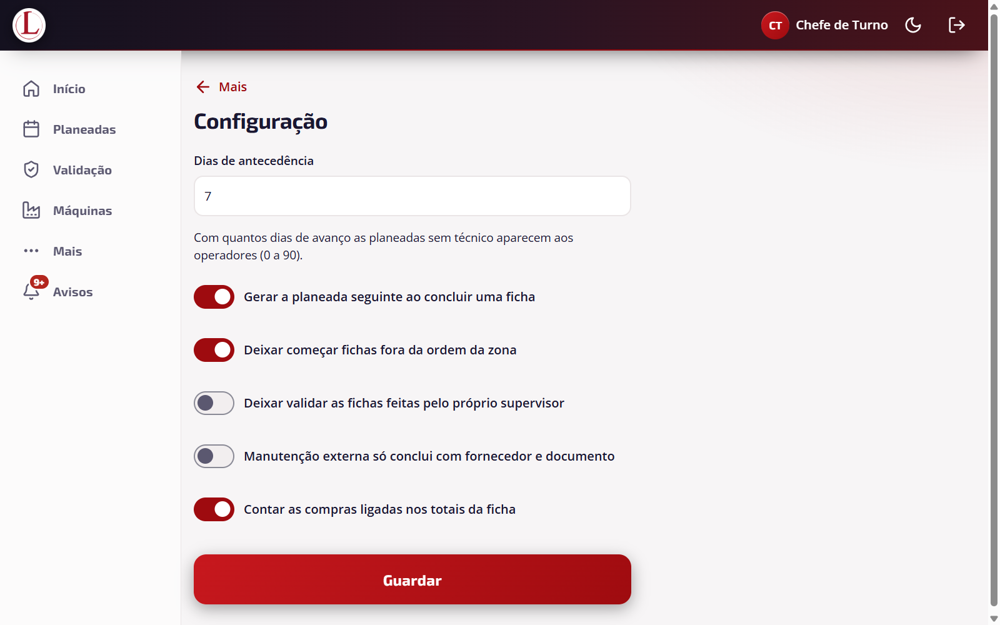 |

| Ficha do equipamento | Equipa |
|---|---|
| 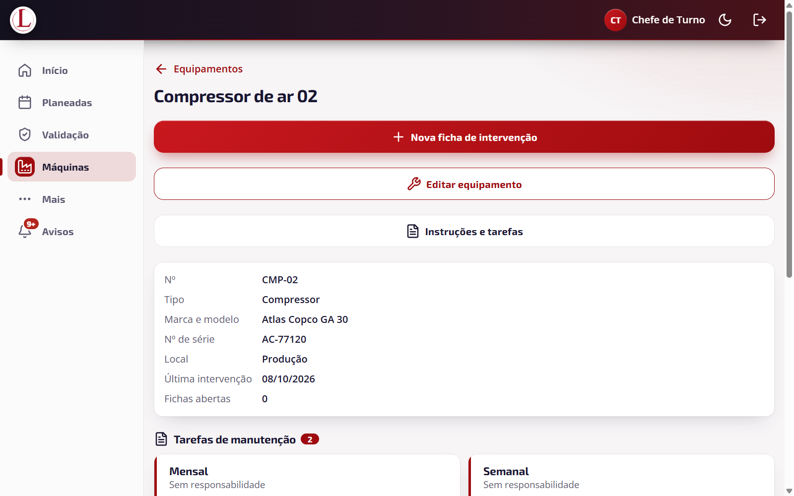 | 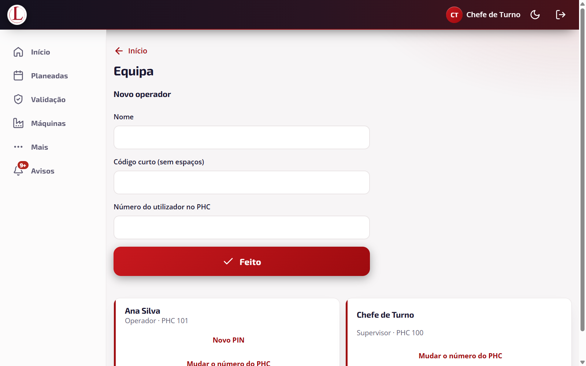 |

Regras para o desktop:

1. O conteúdo ocupa a largura útil à direita do menu; formulários têm largura de leitura confortável (campos em duas colunas) e não se esticam a toda a largura.
2. Hover só com `@media (hover: hover)`; o foco por teclado é sempre visível (`--foco`).
3. Listas e fichas lêem-se da esquerda para a direita; as ações primárias ficam à direita ou na barra fixa.

## 5. Design mobile

Resolução de referência: 390 × 844 (testado também a 320 px).

| Entrada | Início do operador | Início do supervisor |
|---|---|---|
| 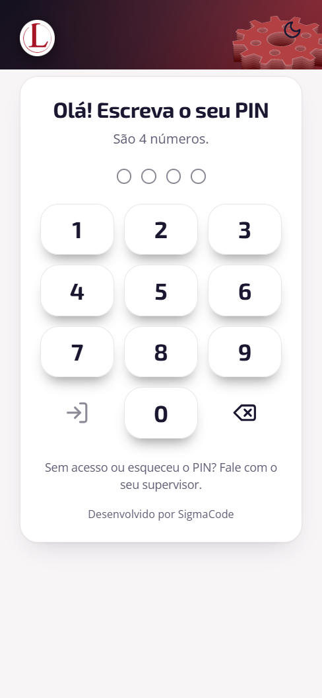 | 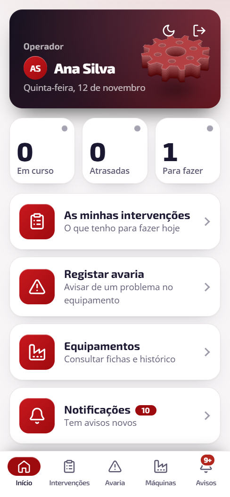 | 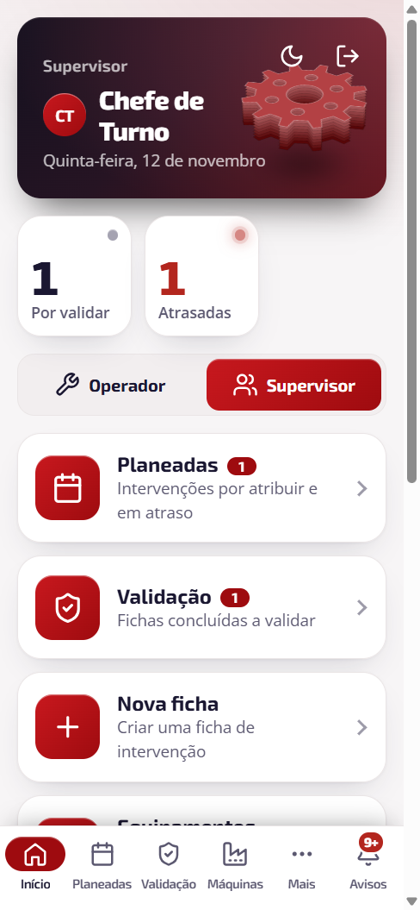 |

| Intervenções | Registar avaria | Validação |
|---|---|---|
| 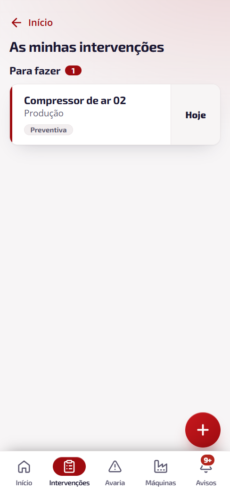 | 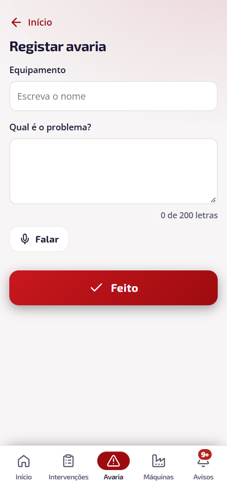 | 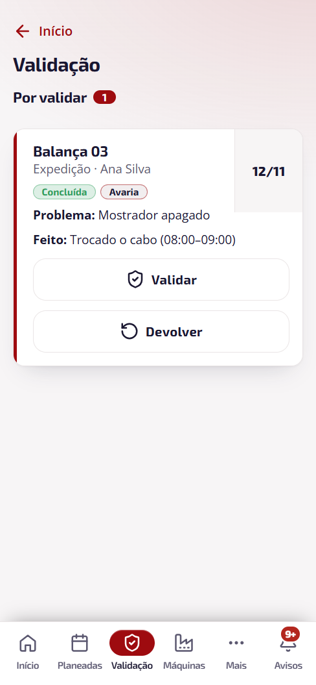 |

| Ficha | Equipamento | Configuração |
|---|---|---|
| 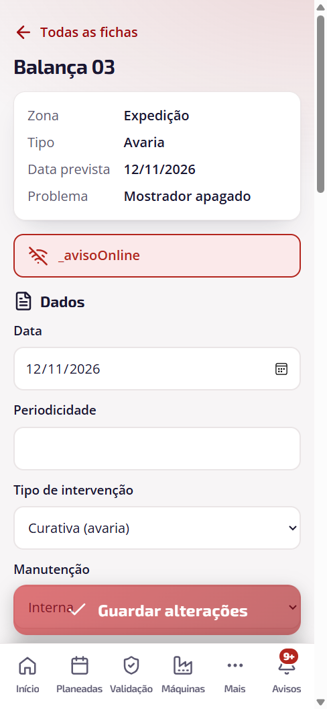 | 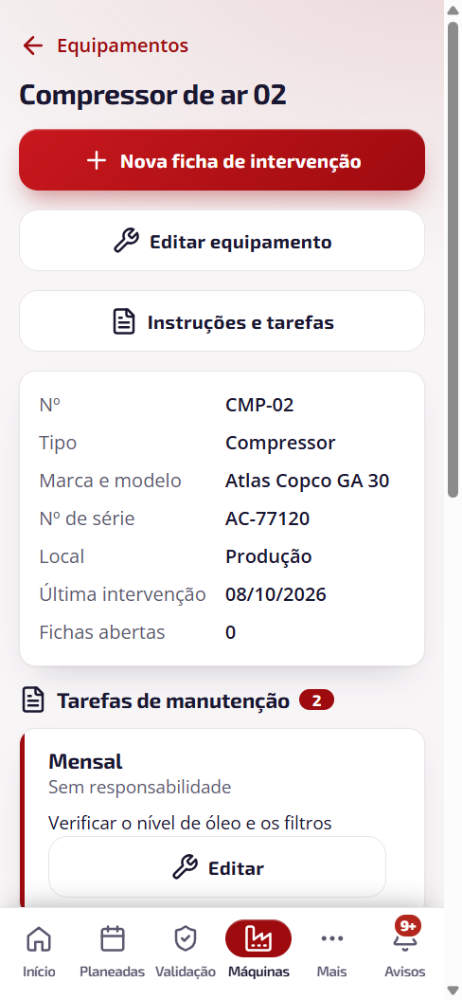 | 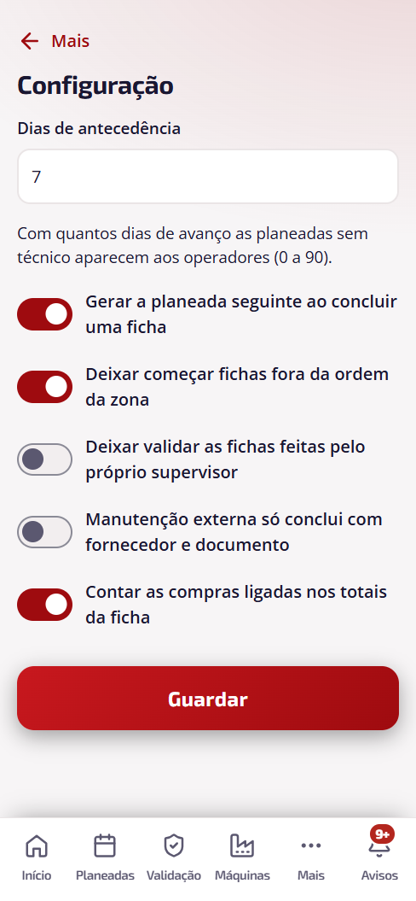 |

Regras para o telemóvel:

1. **Polegar primeiro:** navegação em baixo, botão **+** flutuante em baixo à direita, **Feito** / **Pausar** fixos ao fundo.
2. **Teclado de PIN próprio** (sem teclado do sistema): 3 × 4 teclas, com apagar e entrar. O painel de entrada sobe sobre o cabeçalho (cantos arredondados, sombra para cima).
3. **Texto curto** em cartões; títulos até 2 linhas; o resto trunca ou quebra sem transbordo horizontal.
4. **Ecrãs baixos** (altura < 860 px ou paisagem < 520 px): engrenagem e margens reduzidas para não esconder o conteúdo.
5. **Voz:** botão **Falar** nos campos de descrição (microfone do sistema).
6. **Fotos:** câmara ou galeria.
7. **Segurança de toque:** alvo mínimo 52 px; espaço entre alvos de pelo menos 8 px.

## 6. Componentes

| Componente | Ficheiro | Notas |
|---|---|---|
| Mosaico | `Componentes/Mosaico.razor` | Ícone, título, descrição, contador opcional, seta. |
| Cartão de ficha | `Componentes/FichaCartao.razor` | Barra lateral de cor, equipamento, zona, chip de tipo, prazo à direita. |
| Ficha completa | `Componentes/FichaCompleta.razor` | Dados, execução, horas, material, custos, fotos. |
| Ícones | `Componentes/Icone.razor` | Conjunto único de ícones de traço. |
| Microfone / texto longo | `Microfone.razor`, `TextoLongo.razor` | Ditado e contador "0 de 200 letras". |
| Toast | `Toast.razor` | Aviso de 2 s ao gravar. |
| Confirmação de saída | `ConfirmaSaida.razor` | Aviso de alterações por guardar. |
| Modo visual | `ModoVisual.razor` | Claro/escuro. |

Estados dos chips: *Planeada*, *Em curso*, *Concluída*, *Validada*, *Cancelada*, *Atrasada* (destaque de erro), *Por enviar* (pendente de rede).

## 7. Acessibilidade

- Contraste mínimo 4,5:1 em texto (3:1 em texto grande), validado nos testes dos temas e na auditoria (`Testes-Circuito/auditoria-ux.mjs`).
- Um `h1` por ecrã; `aria-label` nos botões só com ícone (**Terminar sessão**, **Entrar**, **Apagar**).
- Mensagens dinâmicas com `role="status"` ou `role="alert"`.
- Foco visível e ordem de tabulação natural; movimento reduzido respeitado.
- A cor nunca é a única pista: o estado tem sempre texto.

## 8. Como as capturas foram feitas

`Testes-Circuito/capturar-manual.mjs` liga-se por CDP ao WebView2 da app Windows real (API em memória, dados fictícios), percorre as rotas com o perfil Operador e Supervisor e grava as imagens em `docs/manual-img/` nos dois tamanhos (1280 × 800 e 390 × 844). O ambiente é emulado em Windows; o Android não substitui o teste no aparelho.

## 9. Pontos a melhorar (observados nas capturas)

| # | Ecrã | Observação | Sugestão |
|---|---|---|---|
| 1 | Ficha (`/intervencoes/{id}`) | O alerta vermelho mostra o texto literal **`_avisoOnline`** em vez da mensagem. Em `DetalheIntervencao.razor:70` falta o `@`: `Aviso="_avisoOnline"` deve ser `Aviso="@_avisoOnline"`. | Corrigir (uma linha). |
| 2 | Ficha no desktop | O botão fixo **Guardar alterações** cobre o campo **Técnico** ao fim do ecrã. | Reservar espaço inferior (padding) igual à altura da barra fixa. |
| 3 | Início no desktop | Com poucos contadores a linha fica meio vazia. | Manter; ou agrupar com os mosaicos. |
| 4 | Telemóvel | O botão de sair existe só no cartão do Início; nos restantes ecrãs usa-se o menu **Mais**/topo. | Confirmar com utilizadores se chega. |

