# Gestor de Manutenção — Manual do utilizador

Versão: 12/11/2026 · App Windows e Android · Dados dos ecrãs: ambiente de demonstração (dados fictícios)

Este manual explica como usar a app no dia a dia. Há dois perfis: **Operador** (técnico) e **Supervisor**. Cada pessoa entra com o seu PIN e só vê o que o seu perfil permite.

As imagens mostram a app no computador (Windows) e no telemóvel. As funções são as mesmas; só muda a posição do menu (à esquerda no computador, em baixo no telemóvel).

---

## 1. Entrar na app

1. Abra a app. Aparece o ecrã **"Olá! Escreva o seu PIN"**.
2. Toque nos 4 números do seu PIN. Depois toque no botão de entrada (seta) ao lado do 0, caso a app não entre sozinha.
3. Para corrigir, use a tecla de apagar (⌫).

| Computador | Telemóvel |
|---|---|
| 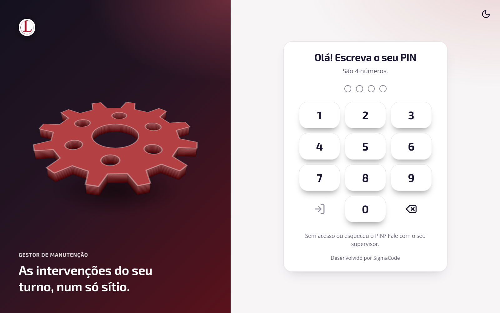 | 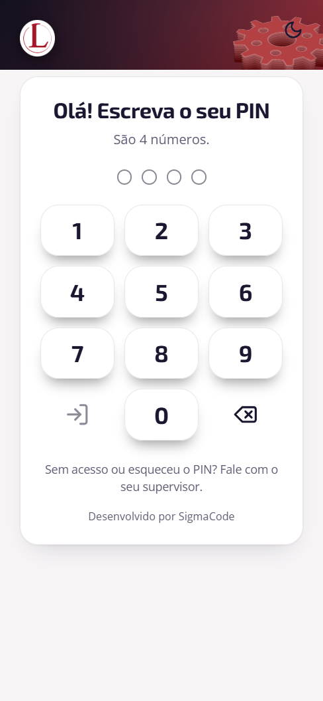 |

- Com demasiadas tentativas a app pede para aguardar um minuto. Se o problema continuar, fale com o seu supervisor.
- **Primeiro acesso:** o PIN que o supervisor lhe deu é provisório e a app pede para o mudar (ecrã *Mudar PIN*). Escolha 4 números que só você saiba, sem sequências como 1234.
- **Esqueceu o PIN?** Só o supervisor o pode repor (ver secção 6.5).
- O botão da lua, no topo, liga o **modo escuro**.
- Para sair use o botão de saída (seta para fora) no topo e confirme em **Sair**.

---

## 2. Conhecer o ecrã

### 2.1 Computador

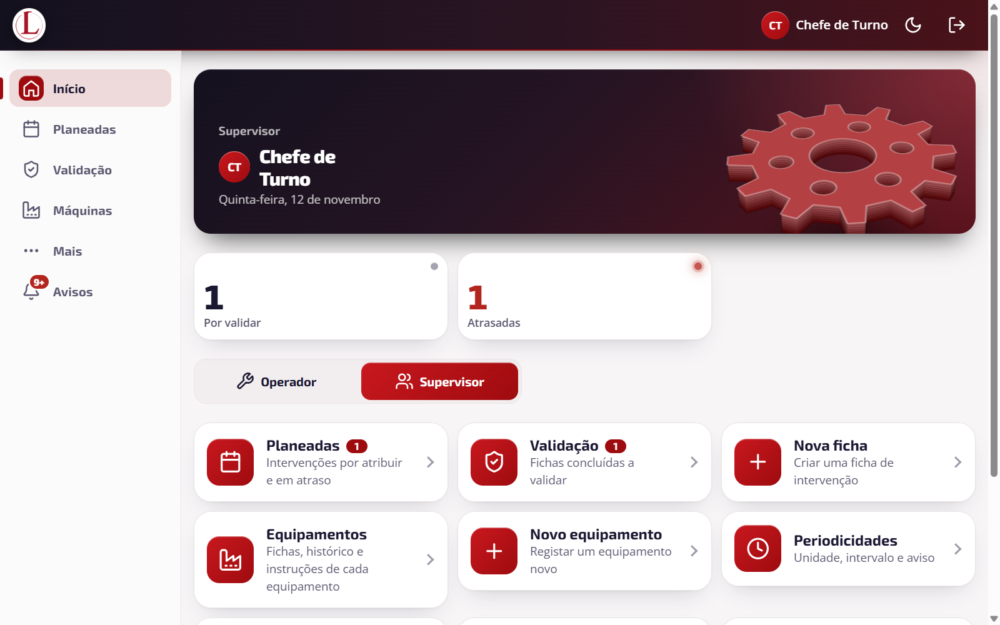

- **Barra de cima:** logótipo, o seu nome, modo escuro e sair.
- **Menu à esquerda:** os atalhos principais do seu perfil e **Avisos** (com o número de avisos por ler).
- **Zona central:** o cabeçalho de boas-vindas, os contadores e os mosaicos.

### 2.2 Telemóvel

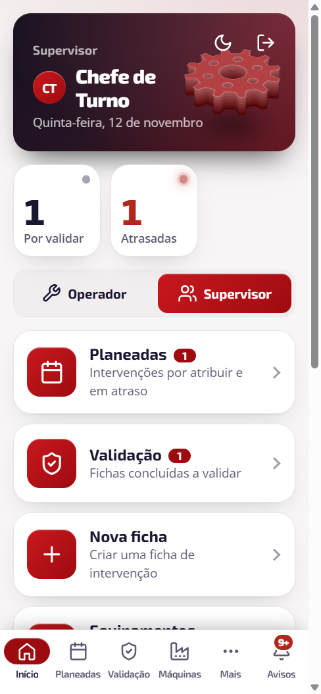

- O menu fica **em baixo** e a lista de mosaicos desce em coluna única.
- O botão **+** (nas listas) cria um registo novo.

### 2.3 O Início

- **Contadores:** quantas fichas tem *em curso*, *atrasadas*, *para fazer* ou *por validar*. O ponto vermelho marca o que pede atenção.
- **Operador / Supervisor:** o supervisor pode alternar entre a vista de operador e a de supervisor.
- **Mosaicos:** atalhos grandes para cada área. O número ao lado do nome é a quantidade pendente.

---

## 3. Operador (técnico)

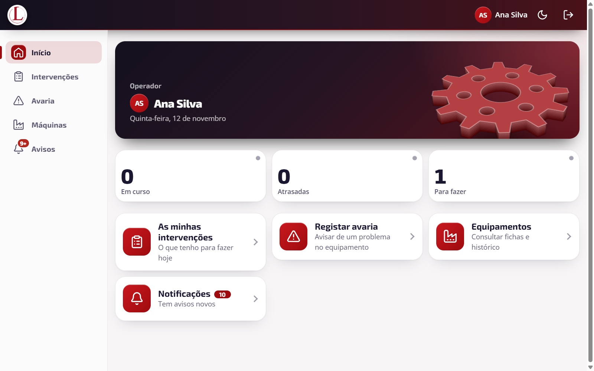

O Início do operador tem três mosaicos: **As minhas intervenções**, **Registar avaria** e **Equipamentos**, mais as **Notificações**.

### 3.1 As minhas intervenções

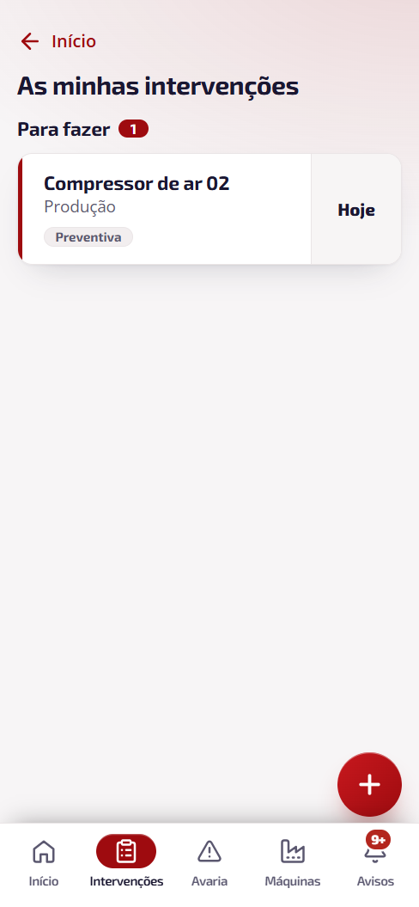

Mostra as fichas que lhe foram atribuídas, em grupos (*Em curso*, *Atrasadas*, *Para fazer*). Cada cartão indica o equipamento, a zona, o tipo (Preventiva ou Curativa) e a data (**Hoje**, **Atrasada**…). Toque num cartão para abrir a ficha.

### 3.2 Fazer uma intervenção

1. Abra a ficha e toque em **Começar**. A ficha passa a *Em curso*.
2. Siga as tarefas da ficha. Registe:
   - **O que fez?** (pode usar **Falar** para ditar);
   - **Horas** (hora de início e de fim) e, se aplicável, **horas de frio** ou de confirmação;
   - **Material:** toque em **Juntar material**, escolha *interno* ou *externo*, indique a quantidade e o preço (se souber) e **Guardar material**;
   - **Fotos:** tire uma foto ou **Escolher da galeria**;
   - **Observações**.
3. Se precisar de parar, use **Pausar**. Pode **retomar** mais tarde sem perder o que registou.
4. No fim toque em **Feito** (botão fixo em baixo). A ficha fica *Concluída*: *"O supervisor vai ver e confirmar."*

**Sem rede?** A app guarda o que fez e envia quando a ligação voltar. Estas fichas aparecem como **Por enviar**.

### 3.3 Registar uma avaria

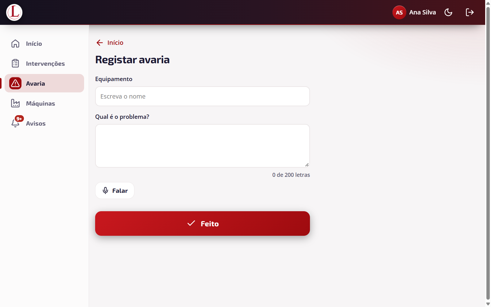

1. No Início toque em **Registar avaria**.
2. Escolha o **Equipamento**.
3. Em **Qual é o problema?** escreva (até 200 letras) ou use **Falar**.
4. Toque em **Feito**. O supervisor recebe o aviso e atribui o trabalho.

### 3.4 Equipamentos

Consulte a ficha e o histórico de cada equipamento (marca, modelo, nº de série, local, últimas intervenções).

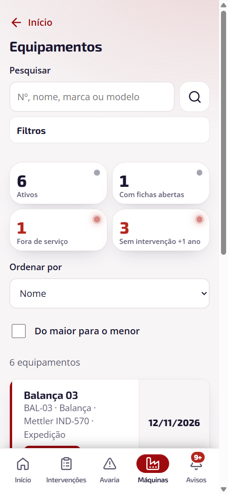

### 3.5 Avisos

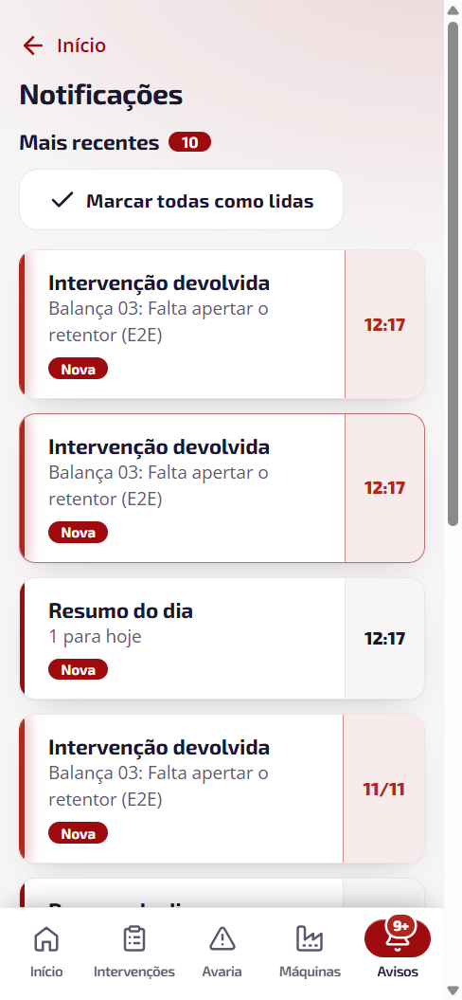

O centro de **Avisos** lista as novidades das suas fichas (nova atribuição, ficha devolvida com o motivo, etc.). Use **Marcar todas como lidas** para limpar a contagem.

> Os avisos só chegam com a app **aberta ou em segundo plano**. Com a app fechada não há aviso.

### 3.6 Ficha devolvida

Se o supervisor devolver uma ficha, ela volta a *Em curso* e mostra **"Devolvida pelo supervisor"** com o motivo. Corrija o que for pedido e volte a tocar em **Feito**.

---

## 4. Supervisor


### 4.1 Validação

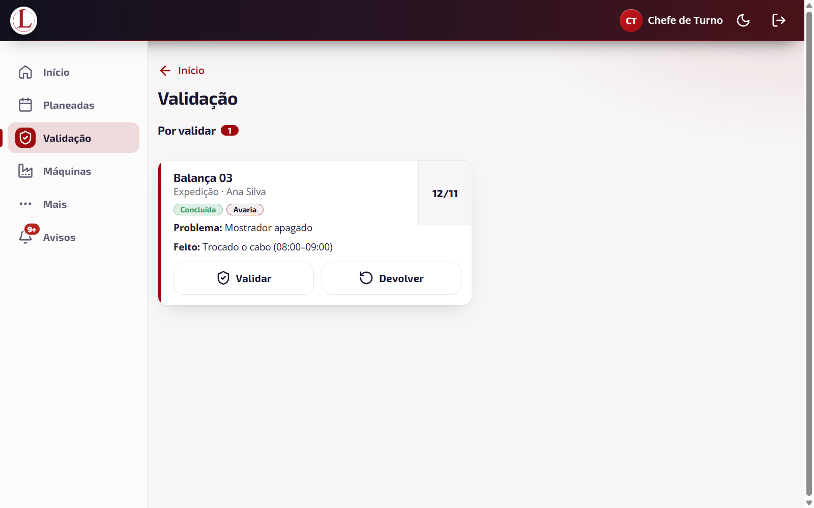

Lista as fichas **Concluídas** a aguardar validação.

- **Validar** aceita a ficha e fecha-a.
- **Devolver** pede o motivo (**Porque devolve?**) e devolve a ficha ao técnico.
- Não pode validar uma ficha que **você próprio concluiu** (a não ser que a configuração o permita).

### 4.2 Planeadas

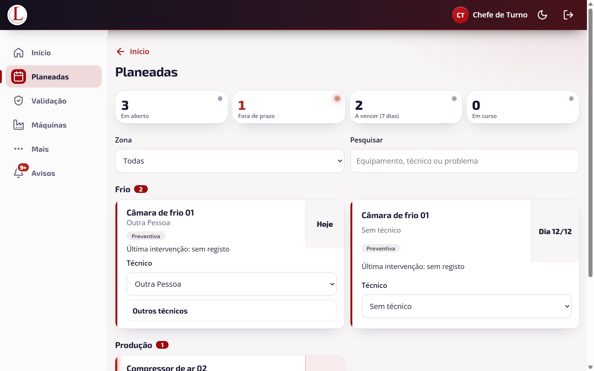

As intervenções preventivas previstas. Mostram a última intervenção e **"Fora de prazo desde"** quando a data prevista já passou. Aqui o supervisor:

- **atribui técnicos** às fichas sem técnico;
- vê o que está **atrasado**.

Ao concluir uma ficha, a app gera a planeada seguinte (se a configuração o permitir).

### 4.3 Nova ficha

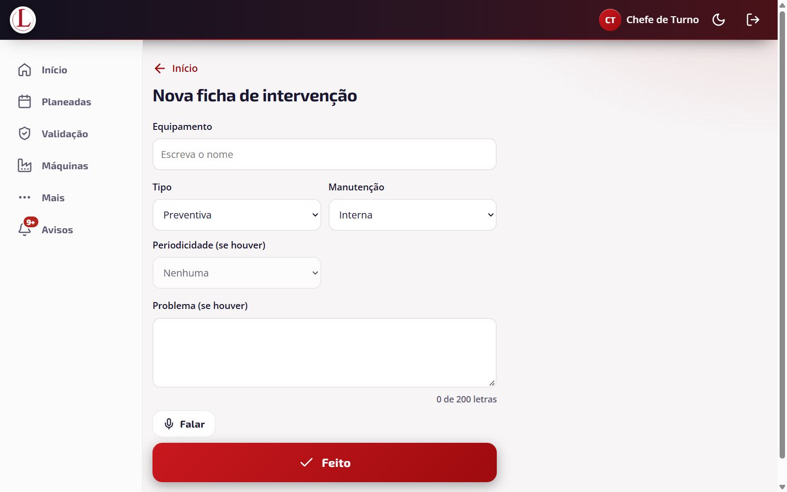

Crie uma ficha à mão: escolha o **Equipamento**, o **Tipo** (*Preventiva* ou *Curativa/avaria*), a **Manutenção** (*Interna* ou *Externa*), a **Periodicidade** (se houver) e, para avarias, descreva o **Problema**. Termine em **Feito**.

### 4.4 Ficha completa e edição

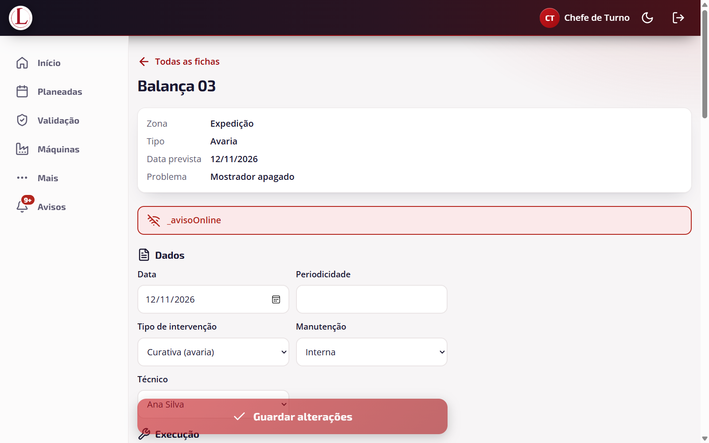

Na ficha o supervisor pode alterar data, periodicidade, tipo, manutenção e **técnico**, ver a execução, o material e os custos e **Guardar alterações** (botão fixo em baixo). **Cancelar intervenção** fecha uma ficha que já não faz sentido.

### 4.5 Todas as fichas

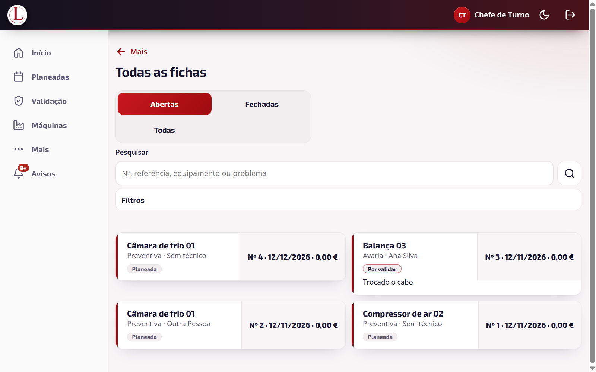

Pesquisa fichas de qualquer estado (*Planeada, Em curso, Concluída, Validada, Cancelada*). Use **Pesquisar** e os filtros.

### 4.6 Por rever

Registos feitos sem rede que o servidor não aceitou. O texto que escreveu fica aqui para o poder copiar; quando já não precisar, toque em **Percebi**.

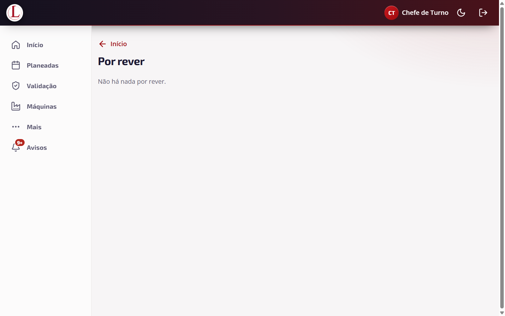

### 4.7 Equipamentos

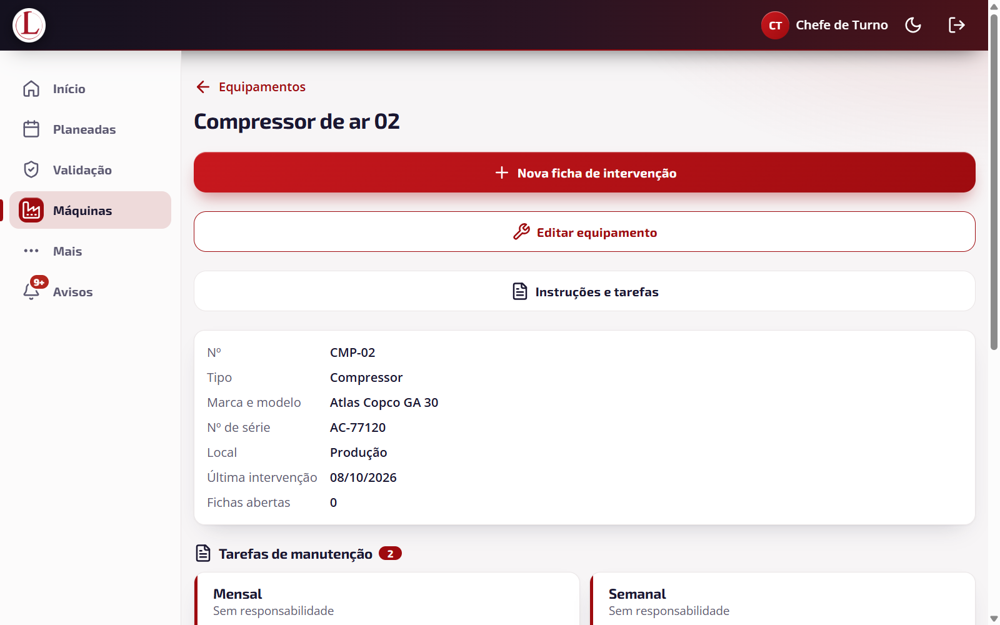

- **Novo equipamento** abre um assistente em 3 passos: *1. Identificação*, *2. Aquisição*, *3. Estado e manual* (**Seguinte** avança).
- Na ficha do equipamento: **Nova ficha de intervenção**, **Editar equipamento** e **Instruções e tarefas**.

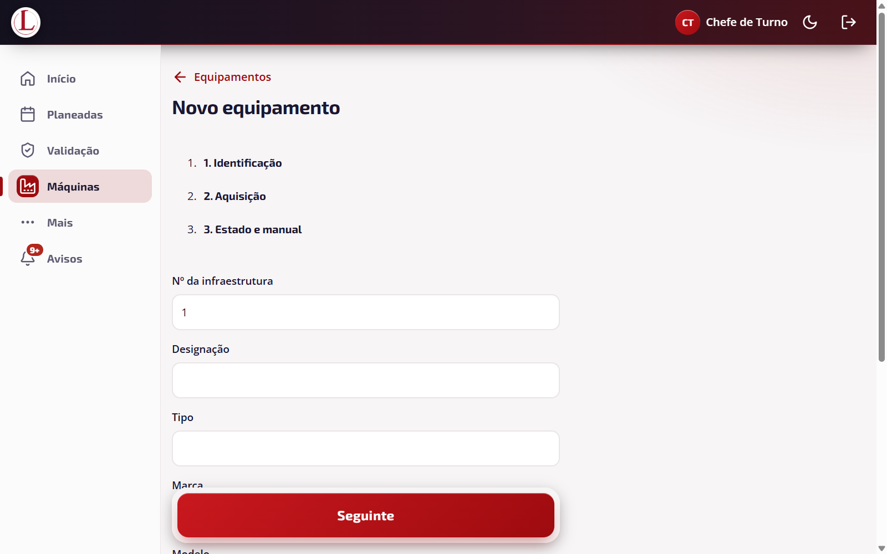

### 4.8 Instruções e tarefas

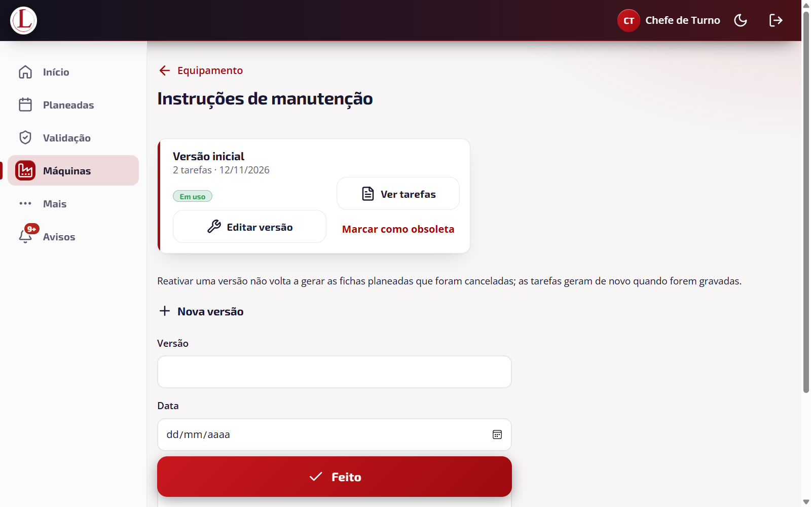

Cada equipamento tem **versões** das instruções de manutenção, cada uma com tarefas.

- **Ver tarefas** / **Editar versão**.
- **Marcar como obsoleta** retira a versão de uso. Reativá-la não volta a gerar as fichas planeadas que já foram retiradas.

### 4.9 Periodicidades

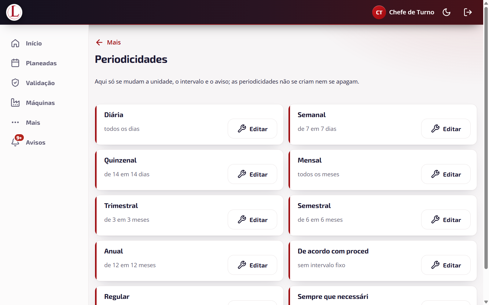

Define a unidade, o intervalo e o aviso de cada periodicidade (por exemplo, mensal com aviso 5 dias antes).

### 4.10 Equipa (utilizadores e PINs)

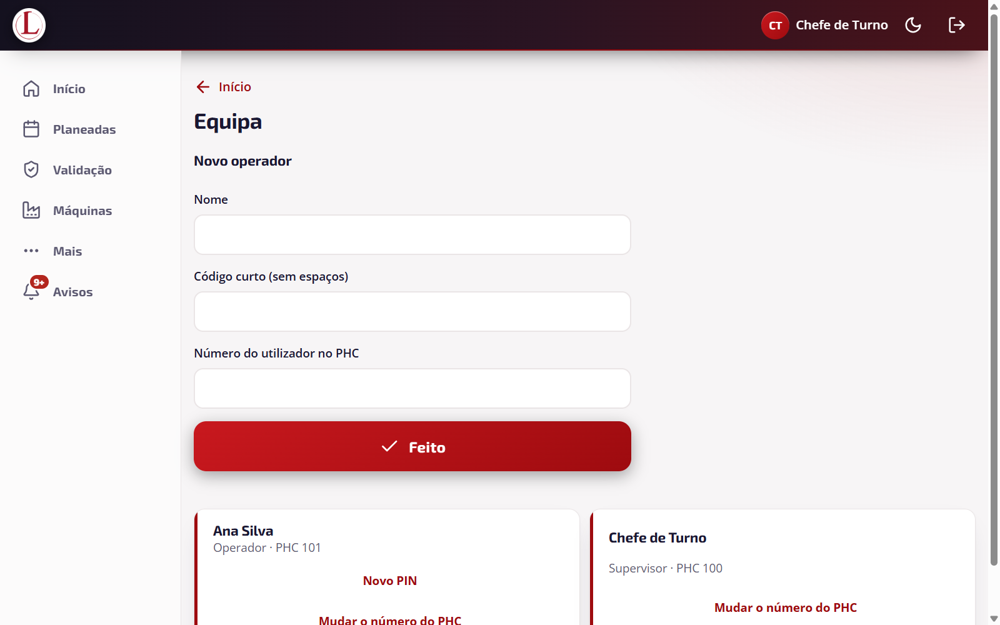

- **Novo operador:** nome, código curto (sem espaços) e número do utilizador no PHC.
- **Novo PIN:** repõe o PIN de alguém (volta a ser provisório e tem de ser mudado no primeiro acesso).
- **Mudar o número do PHC:** liga o técnico ao utilizador PHC correto.

### 4.11 Configuração

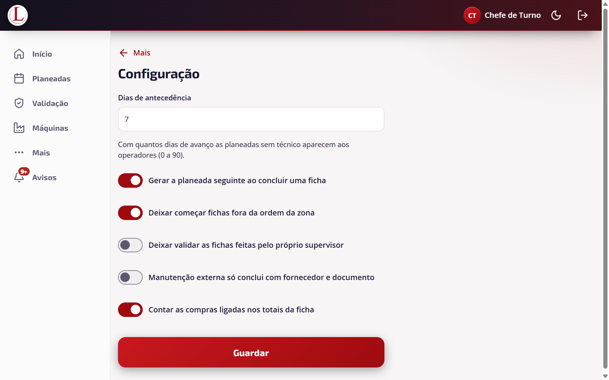

| Opção | O que faz |
|---|---|
| Dias de antecedência (0–90) | Com quantos dias de avanço as planeadas sem técnico aparecem aos operadores. |
| Gerar a planeada seguinte ao concluir uma ficha | Cria automaticamente a próxima planeada. |
| Deixar começar fichas fora da ordem da zona | Permite iniciar uma ficha sem respeitar a ordem. |
| Deixar validar as fichas feitas pelo próprio supervisor | Dispensa um segundo validador. |
| Manutenção externa só conclui com fornecedor e documento | Obriga a indicar fornecedor e documento. |
| Contar as compras ligadas nos totais da ficha | Inclui compras nos custos. |

Termine em **Guardar**.

### 4.12 Mais

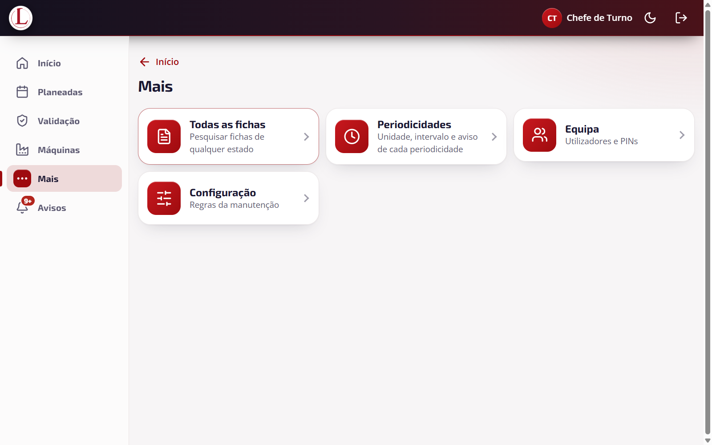

Reúne as áreas menos frequentes: Todas as fichas, Periodicidades, Equipa e Configuração.

---

## 5. Estados de uma ficha

```
Planeada → Em curso → Concluída → Validada
                ↑          │
                └─ Devolvida (com motivo)
Qualquer estado aberto → Cancelada
```

| Estado | Significa |
|---|---|
| Planeada | Prevista, ainda não começou. Pode estar **Atrasada**. |
| Em curso | O técnico começou (pode estar pausada). |
| Concluída | O técnico terminou; falta o supervisor validar. |
| Validada | Aceite pelo supervisor. Fica no histórico. |
| Cancelada | Fechada sem execução. |

---

## 6. Dúvidas frequentes

**6.1 A lista aparece vazia.** Verifique os filtros e a ligação à rede. Toque em **Recarregar a ficha** se a ficha não abrir.

**6.2 Apareceu "Sem ligação".** Pode continuar a registar; a app envia quando houver rede. Se o servidor recusar um registo, ele aparece em *Por rever*. A ficha completa de uma intervenção só se vê com rede.

**6.3 Não recebo avisos.** Só chegam com a app aberta ou em segundo plano. No Android 13 ou superior aceite a permissão de notificações quando a app a pedir.

**6.4 "Esta área é só para supervisores."** O seu perfil é Operador. Peça ao supervisor.

**6.5 Esqueci o PIN.** Peça ao supervisor um novo PIN (Equipa → *Novo PIN*). Terá de o mudar no primeiro acesso.

**6.6 Não consigo validar uma ficha.** Foi você que a concluiu; tem de ser outra pessoa (ou o supervisor ativar a opção na Configuração).

---

*Nota: as capturas foram feitas automaticamente com o Playwright (`Testes-Circuito/capturar-manual.mjs`) sobre a app Windows real, em modo de demonstração.*
